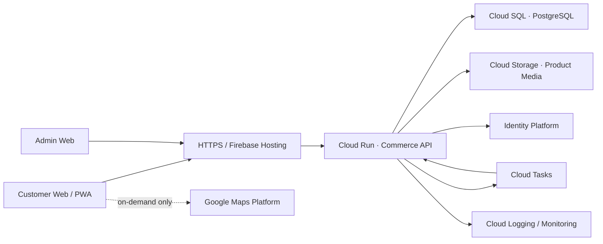
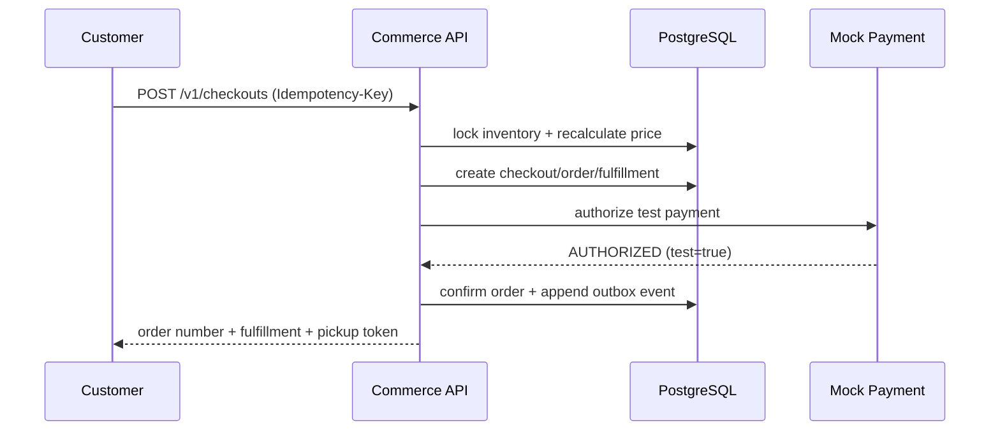
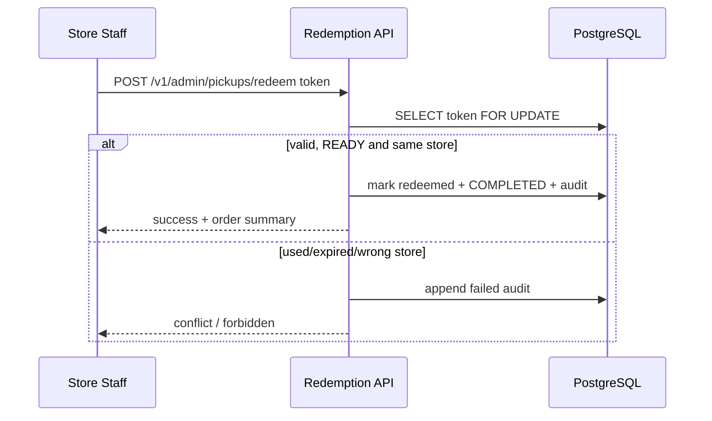

# 02 · 系统架构

## 总体设计

正式系统是前后端分离架构。前端不直接访问数据库，不持有高权限密钥；所有价格、库存、积分和订单状态由后端 API 决定。

## 前端

- 技术：Next.js + TypeScript，响应式 Web/PWA。
- 两个业务入口：客户商城 `/` 和 Admin `/admin`。生产可在同一代码仓内分别构建，也可按安全和发布节奏拆成两个前端项目。
- 客户端负责交互、缓存和乐观 UI；不负责最终价格、优惠合法性、库存扣减或二维码核销判断。
- API Client 统一携带身份令牌、`X-Request-Id`、`Idempotency-Key` 和 locale。
- 原生路线：产品验证后，复用 API 与领域类型，用 Expo React Native 开发 iOS/Android；不把核心业务写进 Web-only 组件。

## 后端：模块化单体

MVP 不建议一开始拆微服务。一个 Cloud Run 服务内按领域隔离模块：

- Identity & Customer
- Catalog & Store Menu
- Cart & Pricing
- Checkout & Payment Adapter
- Order & Fulfillment
- Loyalty & Coupon
- Pickup Redemption
- Admin & Audit
- Notification

模块只能通过公开 service interface 或领域事件协作，不跨模块随意修改表。业务量或团队扩大后可将 Notification、Catalog、Loyalty 等独立拆出。

建议实现：NestJS/Fastify + TypeScript；数据库访问可使用 Drizzle/Prisma。API 版本前缀 `/v1`。

## 关键业务流

### 创建订单

### 自取核销

## 异步和可靠性

- Cloud Tasks：订单超时、通知重试、积分发放、图片处理。队列按任务类型拆分并限制速率。
- Transactional Outbox：订单与事件在同一数据库事务写入，worker 再投递，避免订单成功但通知/积分事件丢失。
- 幂等：结账、支付回调、核销、退款都必须有唯一幂等键或 provider event ID。
- 超时：外部调用必须设置短超时、有限重试和死信/人工处理队列。

## 环境

- `local`：前端 localStorage + mock 数据。
- `dev`：Cloud Run API + 小型 dev 数据库，测试身份。
- `staging`：接近生产配置，使用测试支付、隔离数据。
- `prod`：真实客户数据；变更通过 CI/CD，禁止个人机器直接改库。

每个环境使用独立 GCP project 最清晰；极致省钱阶段可先 dev/staging 共用非生产项目，但数据库和凭据必须隔离。

## 架构决策记录

| 决策 | 选择 | 原因 |
|---|---|---|
| 服务形态 | Cloud Run 模块化单体 | 低闲置成本、少运维、易回滚 |
| 主数据库 | PostgreSQL | 订单事务、约束、报表与生态成熟 |
| 实时数据库 | 暂不选 Firestore 作订单主库 | 复杂订单、库存与核销更适合关系事务 |
| 地图 | 定位后本地算最近店 | 省 Google Maps 调用；无地图也能选店 |
| 支付 | Provider interface + Mock | MVP 快速验证且保留真实接入路径 |
| 应用渠道 | Web/PWA 先行 | 一套代码覆盖三端，最快验证需求 |
| 服务拆分 | 不做早期微服务 | 6 店规模不值得增加网络、数据和运维复杂度 |
