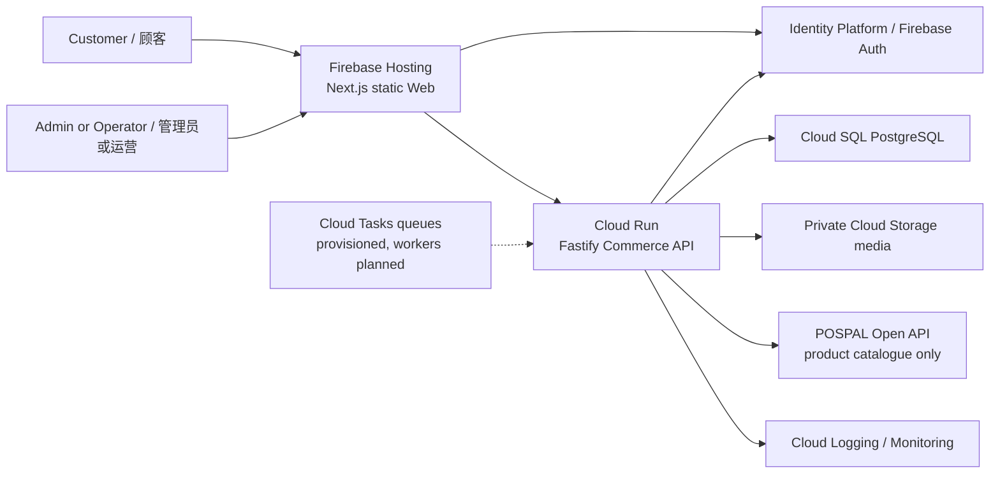
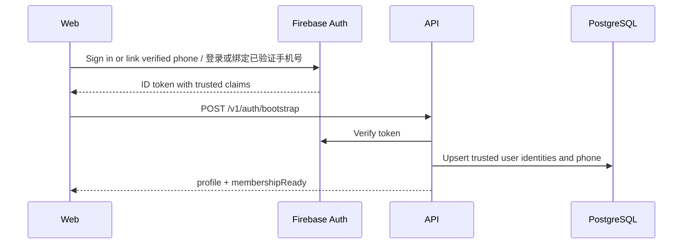
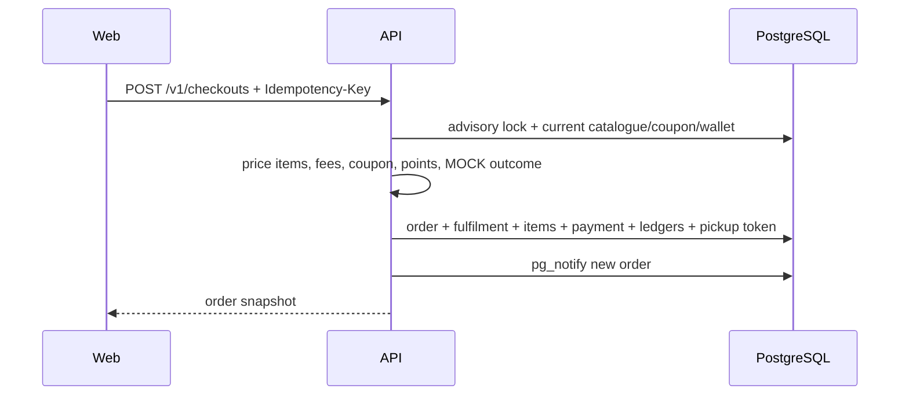

# 02 · System architecture / 系统架构

## Context / 系统上下文

The frontend never connects directly to PostgreSQL or holds privileged credentials. The API is authoritative for identity projection, authorization, price, coupon, points, order state, and pickup redemption. / 前端不直接连接 PostgreSQL，也不持有高权限凭据；API 对身份映射、授权、价格、优惠券、积分、订单状态和取餐核销拥有最终决定权。

## Frontend / 前端

- One Next.js App Router project produces a static export for Firebase Hosting. / 一个 Next.js App Router 项目生成 Firebase Hosting 静态导出。
- Customer and Admin share platform, API, auth, and primitive layers but remain separated by business-domain directories. / 顾客端与 Admin 共用平台、API、认证和基础组件层，同时按业务域目录隔离。
- `KiyoyoApp.tsx` orchestrates customer state; `AdminApp.tsx` orchestrates Admin data and permissions. / `KiyoyoApp.tsx` 编排顾客状态；`AdminApp.tsx` 编排 Admin 数据与权限。
- Static route wrappers make all destinations independently loadable and refresh-safe. / 静态路由包装使所有目的页可独立加载并支持刷新。
- Browser state holds language, guest cart/saved data, and UX continuity; authenticated member data comes from the API. / 浏览器状态保存语言、游客购物车/收藏与体验连续性；已认证会员数据来自 API。

## API modular monolith / API 模块化单体

The TypeScript Fastify API runs as one Cloud Run service. `server.ts` still owns several commerce routes; auth, Admin access/session, loyalty helpers, order events, and POSPAL product sync have dedicated modules. / TypeScript Fastify API 运行于单个 Cloud Run 服务；`server.ts` 仍承载部分商城路由，认证、Admin 权限/会话、积分 helper、订单事件和 POSPAL 商品同步已有独立模块。

| Module / 模块 | Responsibility / 职责 | Status / 状态 |
|---|---|---|
| Auth / 认证 | Firebase token verification, bootstrap, profile and phone gates / Firebase token 校验、bootstrap、资料与手机号门禁 | Implemented / 已实现 |
| Catalogue / 目录 | Products, tags, media, POSPAL fields / 商品、标签、图片、POSPAL 字段 | Implemented / 已实现 |
| Checkout / 结账 | Pricing, coupon, points, MOCK payment, orders / 计价、优惠券、积分、MOCK 支付、订单 | Implemented / 已实现 |
| Admin RBAC / 管理权限 | Roles, permissions, store scope, access history, audit / 角色、权限、门店范围、访问历史、审计 | Implemented / 已实现 |
| Live orders / 实时订单 | PostgreSQL `LISTEN/NOTIFY` to authenticated SSE / PostgreSQL `LISTEN/NOTIFY` 到已认证 SSE | Implemented / 已实现 |
| POSPAL / 银豹 | Signed client and product catalogue sync / 签名客户端与商品目录同步 | Product sync implemented / 商品同步已实现 |
| Async / 异步 | Queues, outbox workers, notifications / 队列、outbox worker、通知 | Queues provisioned; workers planned / 队列已配置，worker 规划中 |

## Authentication flow / 认证流程

Firebase `uid` is the stable external key. Only decoded claims are trusted for provider/email/phone identity; delivery/profile fields never grant membership. / Firebase `uid` 是稳定外部键；provider/邮箱/手机号身份只信任解码后的 claim，配送/资料字段不能授予会员资格。

## Checkout transaction / 结账事务

Only an immediate `PAID` result mutates loyalty. A pending MOCK result cannot reserve points. / 只有立即得到 `PAID` 的结果才会修改积分；等待中的 MOCK 结果不能预留积分。

## Live orders / 实时订单

Checkout and legal status transitions publish `kiyoyo_new_orders` notifications. Each API instance reconnects its listener and forwards events to authorized SSE clients after server-side store filtering. / 结账与合法状态变更发布 `kiyoyo_new_orders` 通知；每个 API 实例会重连 listener，并在服务端门店过滤后把事件转发给已授权 SSE 客户端。

This is true push, not polling. Reconnect and manual refresh compensate for disconnects and direct database edits that do not emit events. / 这是真实推送而非轮询；重连与手工刷新用于补偿断线，以及不会发事件的直接数据库修改。

## Deployment topology / 部署拓扑

- Firebase Hosting: static customer/Admin Web. / Firebase Hosting：静态顾客端/Admin Web。
- Cloud Run service: public HTTPS API with application auth. / Cloud Run service：公开 HTTPS API，使用应用层认证。
- Cloud Run jobs: migrations and seed. / Cloud Run jobs：迁移与 seed。
- Cloud SQL: PostgreSQL source of truth. / Cloud SQL：PostgreSQL 事实来源。
- Cloud Storage: private media; signed upload and API proxy read. / Cloud Storage：私有图片；签名上传与 API 代理读取。
- Artifact Registry, Secret Manager, Identity Platform, Cloud Tasks, Monitoring, Maps key, and GitHub WIF. / Artifact Registry、Secret Manager、Identity Platform、Cloud Tasks、Monitoring、Maps key 与 GitHub WIF。

`kiyoyo-{env}` supports `dev`, `staging`, and `prod` naming in code, but only cloud evidence establishes which environments currently exist. / 代码以 `kiyoyo-{env}` 支持 `dev`、`staging` 与 `prod` 命名，但只有云端证据能确认当前实际存在的环境。

## Decisions / 架构决策

| Decision / 决策 | Choice / 选择 | Reason / 原因 |
|---|---|---|
| Service / 服务 | Modular monolith / 模块化单体 | Transactional flows and simpler operations / 事务流程与更简单运维 |
| Database / 数据库 | PostgreSQL | Constraints, locks, reporting / 约束、锁与报表 |
| Web / Web | Static Next.js + Firebase Hosting / 静态 Next.js + Firebase Hosting | Fast delivery and refresh-safe routes / 快速分发与刷新安全路由 |
| Identity / 身份 | Firebase/Identity Platform | Hosted flows and verified claims / 托管流程与可信 claim |
| Live updates / 实时更新 | PostgreSQL notify + SSE | True push with server store scope / 服务端门店范围内的真实推送 |
| POSPAL / 银豹 | Catalogue source only / 仅目录来源 | Order push/callback is not implemented / 订单推送/回调尚未实现 |
| Payment / 支付 | MOCK adapter / MOCK 适配器 | Product validation without real charges / 不真实扣款的产品验证 |
