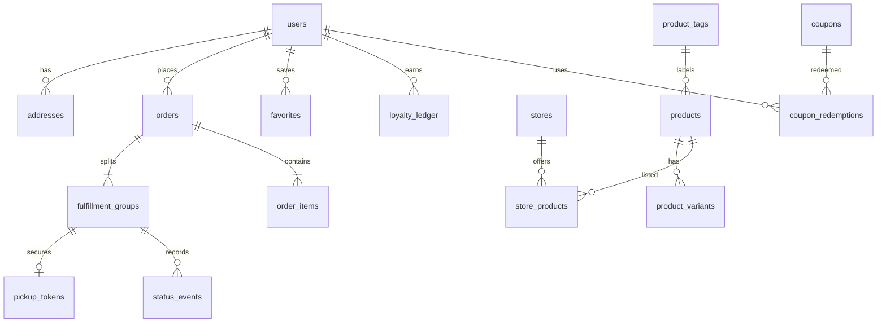

# 03 · 数据模型

数据库：PostgreSQL 16+。主键建议 UUIDv7；时间使用 `timestamptz` 存 UTC，展示时转换 `Africa/Nairobi`。金额用 `integer/bigint` 表示 KES 整数或 minor unit，禁止浮点。

## 核心关系

## 表定义摘要

### 用户与权限

- `users(id, external_auth_id, auth_provider, phone_e164, email, nickname, gender, birth_year nullable, locale, status, created_at)`
- `user_identities(id, user_id, provider, provider_subject, verified_email nullable, linked_at)`；唯一 `(provider, provider_subject)`。
- `addresses(id, user_id, label, contact_name, phone_e164, line1, area, city, lat, lng, delivery_instructions, is_default)`
- `roles(id, code)`、`user_roles(user_id, role_id, store_id nullable)`
- 门店员工角色必须带 `store_id`，总部角色可为空。

### 门店与目录

- `stores(id, code, name, address, phone, lat, lng, timezone, status, pickup_enabled, delivery_enabled, opening_hours_json)`
- `categories(id, kind, slug, name_en, name_zh, sort_order, active)`
- `products(id, kind DRINK|GOODS, slug, name_en, name_zh, description_en, description_zh, image_key, tag_id nullable, base_price, discount_percent, active, catalog_version, updated_at, updated_by)`
- `product_tags(id, label, tone RED|YELLOW|BLACK|GREEN, active, created_at, created_by, updated_at)`；`label` 大小写不敏感唯一，生产环境优先归档而非硬删除。
- `product_media(id, product_id, object_key, content_type, width, height, bytes, status PROCESSING|READY|REJECTED, created_at)`
- `product_change_logs(id, product_id, actor_id, before_json, after_json, created_at)`
- `product_variants(id, product_id, sku, option_json, base_price, stock_tracked, active)`
- `store_products(store_id, variant_id, price, available, stock_on_hand, stock_reserved, updated_at)`
- 商品快照必须复制到 `order_items`，避免改名/改价影响历史订单。

### 购物车、价格与促销

- `carts(id, user_id nullable, guest_token, store_id, currency, expires_at)`
- `cart_items(id, cart_id, variant_id, quantity, customization_json)`
- `coupons(id, code, rule_json, starts_at, ends_at, usage_limit, per_user_limit, active)`
- `coupon_redemptions(id, coupon_id, user_id, order_id, discount_amount, redeemed_at)`
- `pricing_snapshots(id, cart_id, subtotal, discount, delivery_fee, total, rule_version, expires_at)`

### 订单与履约

- `orders(id, order_number unique, user_id, currency, subtotal, discount, delivery_fee, total, payment_status, is_test, created_at)`
- `order_items(id, order_id, fulfillment_group_id, product_id, variant_id, kind, name_snapshot, sku_snapshot, unit_price, quantity, customization_json, line_total)`
- `fulfillment_groups(id, order_id, type PICKUP|DELIVERY|SHIPPING, store_id nullable, address_id nullable, address_snapshot_json nullable, status, promised_at)`
- `status_events(id, fulfillment_group_id, from_status, to_status, actor_id, reason, created_at)`
- `fulfillment_address_events(id, fulfillment_group_id, old_address_snapshot_json, new_address_snapshot_json, actor_id, reason, created_at)`
- `pickup_tokens(id, fulfillment_group_id unique, token_hash unique, expires_at, redeemed_at, redeemed_by, redeemed_store_id)`

### 支付、积分和审计

- `payments(id, order_id, provider, provider_ref, idempotency_key unique, amount, status, is_test, payload_redacted_json, created_at)`
- `loyalty_accounts(user_id unique, balance, tier, version)`
- `loyalty_ledger(id, user_id, order_id nullable, type EARN|SPEND|ADJUST|EXPIRE, points, balance_after, idempotency_key unique, created_at)`
- `audit_logs(id, actor_id, action, entity_type, entity_id, store_id, request_id, metadata_redacted_json, created_at)`
- `outbox_events(id, aggregate_type, aggregate_id, event_type, payload_json, created_at, published_at, attempts)`

## 约束与索引

- `orders.order_number`、`pickup_tokens.token_hash`、`payments.idempotency_key` 唯一。
- `store_products` 唯一 `(store_id, variant_id)`。
- `discount_percent BETWEEN 0 AND 90`；折后价由定价模块计算，不单独接受前端写入。
- `order_items.quantity > 0`；所有金额 `>= 0`。
- `pickup_tokens.redeemed_at` 通过单事务原子设置。
- 常用索引：
  - `orders(user_id, created_at desc)`
  - `fulfillment_groups(store_id, status, promised_at)`
  - `status_events(fulfillment_group_id, created_at)`
  - `audit_logs(entity_type, entity_id, created_at)`
  - `outbox_events(published_at) WHERE published_at IS NULL`

## 迁移与种子数据

- 使用版本化 SQL migration；启动服务时不自动执行生产 migration。
- CI 先做向后兼容 schema 扩展，再发布代码，最后清理旧列。
- 门店、角色、基础品类和测试支付配置由 seed 管理；生产种子必须可重复执行。
- 每个测试订单带 `is_test=true`，经营报表默认排除。
