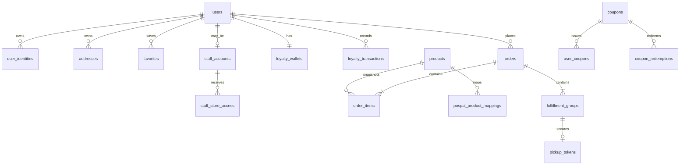

# 03 · Data model and migrations / 数据模型与迁移

PostgreSQL is the transactional source of truth. Times use `timestamptz`; current money fields use non-negative integer KES; internal entity IDs are UUIDs. / PostgreSQL 是交易事实来源；时间使用 `timestamptz`；当前金额字段使用非负整数 KES；内部实体 ID 使用 UUID。

## Domain map / 领域关系

## Identity and staff / 身份与员工

- `users` stores the business profile and trusted Firebase projection, including unique verified phone. / `users` 保存业务资料与可信 Firebase 映射，包括唯一已验证手机号。
- `user_identities` tracks active `PASSWORD`/`GOOGLE` provider subjects; an active identity cannot move between users. / `user_identities` 记录有效 `PASSWORD`/`GOOGLE` provider subject；有效身份不能在用户间转移。
- `addresses` belong to users; a partial unique index allows one default address per user. / `addresses` 归属于用户；部分唯一索引保证每位用户最多一个默认地址。
- `roles` is fixed to `ADMIN` and `OPERATOR`; `staff_accounts`, `staff_store_access`, and `staff_access_periods` model role, scope, state, and history. / `roles` 固定为 `ADMIN` 与 `OPERATOR`；`staff_accounts`、`staff_store_access` 与 `staff_access_periods` 表达角色、范围、状态与历史。
- `audit_logs` records actor, action, entity, store, request ID, and redacted metadata. / `audit_logs` 记录操作者、动作、实体、门店、request ID 与脱敏元数据。

## Catalogue and POSPAL / 目录与 POSPAL

- `stores` includes commerce flags, verified location, opening hours, and optional POSPAL account/enabled state. / `stores` 包含商城开关、位置验证、营业时间及可选 POSPAL 账号/启用状态。
- `products` includes bilingual Web fields, price/discount/active/version, media, size prices, POSPAL UID/barcode/category/tastes/images/no-stock, and manual override. / `products` 包含双语 Web 字段、价格/折扣/上下架/版本、图片、杯型价格，以及 POSPAL UID/条码/分类/口味/图片/不记库存与手工覆盖。
- `product_tags` supplies reusable display labels; `favorites` joins users and products. / `product_tags` 提供可复用展示标签；`favorites` 关联用户与商品。
- POSPAL categories, tastes, mappings, and sync state retain source dictionaries, matching, and cursors. / POSPAL 分类、口味、映射与同步状态保存来源字典、匹配与游标。
- Barcode suffix `-1` is merged as the main product's large-size price. / 条码后缀 `-1` 合并为主商品的大杯价格。

## Orders, coupons, and loyalty / 订单、优惠券与积分

- `orders` snapshots subtotal, coupon discount, delivery fee, point fields, total, payment status, and test flag. / `orders` 快照保存小计、优惠券折扣、配送费、积分字段、总额、支付状态和测试标记。
- `fulfillment_groups` stores type, store/address snapshot and state; `order_items` stores product/customization price snapshots. / `fulfillment_groups` 保存类型、门店/地址快照与状态；`order_items` 保存商品/定制价格快照。
- `payments.idempotency_key` is unique. `pickup_tokens` store token hashes and redemption metadata; `status_events` append history. / `payments.idempotency_key` 唯一；`pickup_tokens` 保存 token 哈希与核销元数据；`status_events` 追加历史。
- `coupons`, `user_coupons`, and `coupon_redemptions` separate campaign rules, member issuance, and order redemption. / `coupons`、`user_coupons` 与 `coupon_redemptions` 分别表达活动规则、会员发放与订单核销。
- `loyalty_settings` stores the singleton rate; `loyalty_wallets` stores aggregates; `loyalty_transactions` is the idempotent auditable ledger. / `loyalty_settings` 保存单例比例；`loyalty_wallets` 保存汇总；`loyalty_transactions` 是幂等、可审计账本。
- A trigger rejects ledger update/delete except deletion of `is_test=true` rows during explicit test-data cleanup. / trigger 拒绝账本 update/delete，只有明确清理测试数据时允许删除 `is_test=true` 行。

## Migration order / 迁移顺序

| Migration / 迁移 | Purpose / 用途 |
|---|---|
| `0001_initial.sql` | Core commerce, fulfilment, payment, pickup, audit / 核心商城、履约、支付、取餐与审计 |
| `0002_menu_size_prices.sql` | Per-size pricing / 分杯型价格 |
| `0003_coupon_management.sql` | Coupon campaigns, wallet, redemption / 优惠券活动、钱包与核销 |
| `0004_admin_rbac.sql` | Staff roles, store scope, access periods / 员工角色、门店范围与访问周期 |
| `0004_customer_auth.sql` | Provider identities and auth timestamps / provider 身份与认证时间 |
| `0005`–`0010` | POSPAL mapping, catalogue fields, resync, override, variant dedupe / POSPAL 映射、目录字段、重同步、覆盖与变体去重 |
| `0009_verified_phone_membership.sql` | Unique verified E.164 phone / 唯一已验证 E.164 手机号 |
| `0011_loyalty_points.sql` | Settings, wallet, ledger, order snapshots / 设置、钱包、账本与订单快照 |
| `0012_loyalty_ledger_immutability.sql` | Ledger immutability / 账本不可变 |

Duplicate numeric prefixes exist for independent historical migrations. The runner uses filename lexical order; never renumber applied files. / 因历史独立开发存在重复数字前缀；runner 按文件名字典序执行，不得重编号已执行文件。

Schema truth is the ordered SQL in `api/migrations/`; this document is a map, not a replacement for migration review. / Schema 最终事实是 `api/migrations/` 中按顺序执行的 SQL；本文是地图，不能替代迁移审查。
