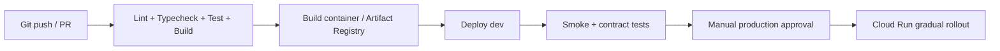

# 05 · GCP 部署、区域与成本

## 最省钱且少运维的 MVP 组合

| 能力 | GCP 服务 | MVP 配置 |
|---|---|---|
| Web 静态资源 | Firebase Hosting | CDN、自动 TLS；动态请求转 API |
| 后端 API | Cloud Run | min instances 0；1 vCPU / 512MiB；按请求计费 |
| 关系数据库 | Cloud SQL PostgreSQL | 最小 shared-core、单区、20GB SSD、自动备份 |
| 图片 | Cloud Storage | WebP/AVIF 派生图，长缓存 |
| 异步任务 | Cloud Tasks | 通知、超时、积分与重试 |
| 身份 | Identity Platform | 手机/邮箱；Admin MFA |
| 密钥 | Secret Manager | 数据库、支付、签名密钥 |
| 地图 | Maps JavaScript / Routes 按需 | 首屏不加载地图；最近店本地计算 |
| 日志告警 | Cloud Logging / Monitoring | 结构化日志、错误率和延迟告警 |

## 区域选择

肯尼亚目前没有 GCP region。选择必须同时看客户延迟、服务可用性和数据库价格：

1. 用 Cloud Run/Cloud SQL 共同支持的区域做实测，候选优先欧洲或中东邻近区域。
2. Cloud Run 和 Cloud SQL 必须同区，避免跨区延迟和流量费。
3. 对 Nairobi 网络进行 7 天真实探测，再决定生产区；不要只按地图距离。
4. 中东区域不一定更便宜；部分服务价格反而高于主流欧洲区。MVP 通常应优先“价格成熟、服务完整的欧洲区”，若中东区对本地运营商延迟显著更低再切换。
5. 区域通过 Terraform/配置变量控制，避免写死。

对 6 店初期，数据库往往是主要固定成本，Cloud Run min instances 0 的闲置成本接近零。若 Cloud SQL 月成本仍不能接受，可在极早期 dev 使用托管 Serverless Postgres，但生产订单仍建议关系数据库；迁移收益需要大于双云运维成本。

## 项目与网络

- 推荐项目：`kiyoyo-dev`、`kiyoyo-staging`、`kiyoyo-prod`。
- Cloud Run 使用第二代执行环境；仅允许 HTTPS。
- Cloud SQL 不开放公网白名单；通过 Cloud SQL connector 连接。
- 连接池严格限制，按 Cloud Run 最大实例数预算总连接数。初始可设 API concurrency 40、max instances 5、每实例 pool 5，再按指标调优。
- Admin API 与 Customer API 可先共用服务，但路由强制 RBAC；规模扩大后再拆。

## Identity Platform 配置

- 启用 Email/Password、Google、Facebook provider；邮箱登录启用邮箱验证和重置密码邮件模板。
- Google OAuth 配置 consent screen、正式域名和 dev/staging/prod 回调地址。
- Facebook 创建 KIYOYO Meta App，Secret 存 Secret Manager，完成隐私政策、数据删除 URL 和上线审核。
- 客户前端只使用公开 Web config；provider secret 仅存在 GCP/Identity Platform。Commerce API 验证 Identity Platform ID token 后才读写个人资料和地址。
- 本地开发使用 emulator 或明确标记的 mock adapter；正式 build 中禁止自动回退到 mock auth。

## CI/CD

- 使用 Workload Identity Federation，CI 不保存长期 service account key。
- 容器按 digest 部署；Cloud Run 保留前一 revision，可立即回滚。
- Migration 独立 job 执行；先兼容 schema，再部署应用。
- Terraform 管理服务、IAM、预算和告警；秘密值不进入 Git。

## 成本控制

- Cloud Run：`min-instances=0`、限制 `max-instances`，静态图片不经 API。
- Cloud SQL：MVP 单区 shared-core；上线前确认规格支持 SLA 和负载。HA 等稳定营收后启用。
- Storage/CDN：上传时生成多尺寸 WebP/AVIF；immutable 缓存一年。
- 商品图片使用不可变 object key（含内容 hash/version），不要覆盖同名文件；更新数据库引用即可让 CDN 安全切换，旧图按生命周期策略清理。
- Maps：限制 API key 的网站域名/API；只开放需要的 API；设置配额。
- Logging：过滤健康检查和低价值访问日志，设置 30 天保留。
- Budget：设置月预算和 50/80/100% 告警。注意预算告警不会自动停止资源。
- 每周查看账单按 SKU 拆分；为 dev 设置夜间清理和数据库停机策略。

## 初始容量与扩容触发

- 目标 API p95 < 500ms（不含第三方支付），错误率 < 1%。
- 数据库 CPU 连续 15 分钟 > 65%、连接 > 70% 或磁盘 > 70% 时评估升级。
- Cloud Run 冷启动若明显影响结账，再把生产 min instances 从 0 调到 1；不要预先付闲置成本。
- 当单个模块独立吞吐或发布节奏成为瓶颈，再拆服务，而不是按组织图提前拆。

## 当前 GCP 阻塞项

本机当前 gcloud 活跃账号为 `kechengyang234@gmail.com`，配置项目是 `ephemeral-1d9a4`；该账号查询项目 ID `kiyoyo` 返回无权限或项目不存在。继续部署前需要完成其一：

1. `gcloud auth login` 切换到创建 `kiyoyo` 的账号；或
2. 在项目 IAM 中为当前账号授予合适角色；或
3. 确认控制台显示的真实 Project ID（项目名称可以叫 KIYOYO，但 ID 可能不同）。

不要为了绕过权限把项目凭据、service-account JSON 或数据库密码提交到仓库。
