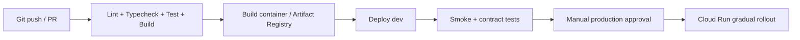

# 05 · GCP 部署、区域与成本

## 当前 `kiyoyo-dev` 状态（2026-08-05）

本环境已经部署到 GCP 项目 `kiyoyo`，统一资源前缀为
`kiyoyo-dev`，主区域为 `europe-west1`。

| 能力 | 已部署资源 | 当前状态 |
|---|---|---|
| 顾客 Web / Admin | Firebase Hosting `kiyoyo-dev` | https://kiyoyo-dev.web.app |
| Commerce API | Cloud Run `kiyoyo-dev-api` | min 0、max 5、1 vCPU / 512 MiB |
| PostgreSQL | Cloud SQL `kiyoyo-dev-db` | PostgreSQL 16、`db-f1-micro`、20GB SSD、单区 |
| 数据库 | `kiyoyo_dev` / `kiyoyo_dev_api` | Migration 与 seed 已完成 |
| 商品图片 | `gs://kiyoyo-dev-media` | 私有、PAP、统一访问、CORS 与生命周期规则 |
| 容器镜像 | Artifact Registry `kiyoyo-dev` | API 镜像按不可变版本部署 |
| 异步任务 | `kiyoyo-dev-order-events`、`kiyoyo-dev-media-processing` | Cloud Tasks 队列已创建 |
| 认证 | Identity Platform | Email/Password 已启用；Google 等待 OAuth 凭据 |
| 地图 | Maps JavaScript API / Routes API | Browser key 已限定域名和 API |
| 密钥 | Secret Manager | DB 密码与自取签名密钥；不进入 Terraform state |
| IaC 状态 | `gs://kiyoyo-dev-tfstate` | 版本控制、统一 bucket 访问 |
| 预算 | Billing Budget `kiyoyo-dev monthly budget` | 账单币种 30 单位/月；50/80/100% 与预测超支阈值 |
| 可用性 | Monitoring uptime check | 每 5 分钟检查 API `/readyz` |
| 告警 | Cloud Monitoring | API 不可用、Cloud Run 5xx、Cloud SQL CPU |

前后端是分离部署：Firebase Hosting 只承载静态前端，所有用户、地址、商品、订单、
优惠、标签、图片与核销操作都通过 Cloud Run API 进入 Cloud SQL / Cloud Storage。

## `kiyoyo.africa` 自定义域名发布

`kiyoyo.africa` 是 `kiyoyo-dev` Hosting site 的主域名，`www.kiyoyo.africa` 仅做 301
跳转。域名切换不会把 dev 环境变成 production：API、Cloud SQL、支付通道和数据仍属于
`kiyoyo-dev`。正式营业前必须单独完成生产环境与真实支付发布评审。

发布使用 Firebase Hosting Advanced Setup，避免在证书准备前切走现有网站：

1. 在 Hosting site `kiyoyo-dev` 创建 `kiyoyo.africa` custom domain，但先不修改现有
   A/AAAA/CNAME 流量记录。
2. 在 DNS 服务商添加 Firebase 返回的 ownership、ACME 和必要的 CAA 记录；保留邮件的
   MX、SPF、DKIM、DMARC 记录，也不更换 nameserver。
3. 应用 Terraform，把 `custom_domains` 同步到 Cloud Run `ALLOWED_ORIGINS`、Cloud
   Storage CORS、Maps browser referrer 与 Identity Platform authorized domains。
4. 部署 Web。Web 仅在浏览器实际位于 `kiyoyo.africa` 或其 `www` hostname 时采用
   `kiyoyo.africa` 作为 Firebase `authDomain`；`kiyoyo-dev.web.app` 与 localhost 在切换
   前后继续使用 `kiyoyo.firebaseapp.com`。
5. Firebase 显示 ownership active 且证书已准备完成后，才把根域 A/AAAA 和 `www`
   CNAME 改成向导当前给出的值。不得复制历史 IP 或其他项目的 DNS 值。
6. 验证根域、`www` 301、`/admin`、注册登录、邮箱动作、地图、媒体、结账、订单历史与
   取餐码。确认后保留 Firebase ownership TXT，供证书自动续期。

回滚 DNS 时只恢复切换前已记录的 Web A/AAAA/CNAME；不得恢复、删除或覆盖邮件记录。
Firebase 自定义域名资源与 ownership TXT 应保留到回滚调查完成。

### 已验证链路

- 线上 Hosting、API `/readyz`、12 杯饮品、6 家门店与最近门店排序均正常。
- Email/Password 注册、用户资料、默认配送地址、模拟支付与订单历史均通过。
- 自取订单会生成签名二维码；重复提交会命中 Idempotency-Key，不会生成重复订单。
- 登录后 History 从 Cloud SQL 同步商品、门店、地址与履约状态；跨设备重新签发取餐码时
  旧 token hash 被原子替换，旧二维码失效。
- 普通用户访问 Admin API 返回 403；Admin 路由实施服务端 RBAC。
- Web production build、ESLint、静态渲染测试与 production dependency audit 均通过。
- Monitoring email channel 已创建；收件人需要按 Google 邮件提示完成验证后才会收到运行告警。

## 最省钱且少运维的 MVP 组合

| 能力 | GCP 服务 | MVP 配置 |
|---|---|---|
| Web 静态资源 | Firebase Hosting | CDN、自动 TLS；动态请求转 API |
| 后端 API | Cloud Run | min instances 0；1 vCPU / 512MiB；按请求计费 |
| 关系数据库 | Cloud SQL PostgreSQL | 最小 shared-core、单区、20GB SSD、自动备份 |
| 图片 | Cloud Storage | WebP/AVIF 派生图，长缓存 |
| 异步任务 | Cloud Tasks | 通知、超时、积分与重试 |
| 身份 | Identity Platform | 手机/邮箱；Admin MFA |
| 密钥 | Secret Manager | 数据库、支付、签名密钥 |
| 地图 | Maps JavaScript / Routes 按需 | 首屏不加载地图；最近店本地计算 |
| 日志告警 | Cloud Logging / Monitoring | 结构化日志、错误率和延迟告警 |

## 区域选择

肯尼亚目前没有 GCP region。选择必须同时看客户延迟、服务可用性和数据库价格：

1. 用 Cloud Run/Cloud SQL 共同支持的区域做实测，候选优先欧洲或中东邻近区域。
2. Cloud Run 和 Cloud SQL 必须同区，避免跨区延迟和流量费。
3. 对 Nairobi 网络进行 7 天真实探测，再决定生产区；不要只按地图距离。
4. 中东区域不一定更便宜；部分服务价格反而高于主流欧洲区。MVP 通常应优先“价格成熟、服务完整的欧洲区”，若中东区对本地运营商延迟显著更低再切换。
5. 区域通过 Terraform/配置变量控制，避免写死。

对 6 店初期，数据库往往是主要固定成本，Cloud Run min instances 0 的闲置成本接近零。若 Cloud SQL 月成本仍不能接受，可在极早期 dev 使用托管 Serverless Postgres，但生产订单仍建议关系数据库；迁移收益需要大于双云运维成本。

## 项目与网络

- 当前按经营方要求使用单一 GCP 项目 `kiyoyo`，KIYOYO 自建资源统一使用
  `kiyoyo-{env}` 前缀，例如 `kiyoyo-dev-api`、`kiyoyo-staging-api`、
  `kiyoyo-prod-api`。Terraform state、tfvars、Hosting site、数据库、Bucket、Service
  Account 和监控策略必须按环境隔离；不能让 staging/prod 复用 dev backend 或镜像。
- GCP 自动创建的默认 Service Account、Firebase project 级对象和 Cloud Build staging
  bucket 可能使用平台固定名称，不受自定义前缀控制。除此之外，KIYOYO 自建资源必须
  遵守前缀规则。
- 若以后需要更强的账单、IAM 或合规隔离，再把环境拆为独立 GCP project；资源前缀规则
  仍保持不变。
- Cloud Run 使用第二代执行环境；仅允许 HTTPS。
- Cloud SQL 不开放公网白名单；通过 Cloud SQL connector 连接。
- 连接池严格限制，按 Cloud Run 最大实例数预算总连接数。初始可设 API concurrency 40、max instances 5、每实例 pool 5，再按指标调优。
- Admin API 与 Customer API 可先共用服务，但路由强制 RBAC；规模扩大后再拆。

## Identity Platform 配置

- Email/Password 已启用；Google 前端入口已完成，但 provider 需要真实 OAuth
  Client ID / Client Secret 后才能启用。不得使用伪造或共享凭据。
- 上生产前启用邮箱验证和重置密码邮件模板。
- Google OAuth 配置 consent screen、正式域名和 dev/staging/prod 回调地址。
- 客户前端只使用公开 Web config；provider secret 仅存在 GCP/Identity Platform。Commerce API 验证 Identity Platform ID token 后才读写个人资料和地址。
- 本地开发使用 emulator 或明确标记的 mock adapter；正式 build 中禁止自动回退到 mock auth。

## CI/CD



- 使用 Workload Identity Federation，CI 不保存长期 service account key。
- 容器按 digest 部署；Cloud Run 保留前一 revision，可立即回滚。
- Migration 独立 job 执行；先兼容 schema，再部署应用。
- Terraform 管理服务、IAM、预算和告警；秘密值不进入 Git。

### 当前前端发布产物

Firebase Hosting 的目录是 `web/out`。标准生产构建为：

```sh
cd web
npm run lint
npm test
npm run build
```

`npm run build:preview` 生成本地 vinext 预览产物 `web/dist`，不能替代上述 Firebase 静态导出。
每个 staging/prod 构建必须显式提供 `NEXT_PUBLIC_*` 环境配置；缺失时构建会失败，防止
正式前端误连 `kiyoyo-dev`。dev 保留受域名/API 限制的公开 Web 配置作为本地默认值。

## 成本控制

- Cloud Run：`min-instances=0`、限制 `max-instances`，静态图片不经 API。
- Cloud SQL：MVP 单区 shared-core；上线前确认规格支持 SLA 和负载。HA 等稳定营收后启用。
- Storage/CDN：上传时生成多尺寸 WebP/AVIF；immutable 缓存一年。
- 商品图片使用不可变 object key（含内容 hash/version），不要覆盖同名文件；更新数据库引用即可让 CDN 安全切换，旧图按生命周期策略清理。
- Maps：限制 API key 的网站域名/API；只开放需要的 API；设置配额。
- Logging：过滤健康检查和低价值访问日志，设置 30 天保留。
- Budget：设置月预算和 50/80/100% 告警。注意预算告警不会自动停止资源。
- 每周查看账单按 SKU 拆分；为 dev 设置夜间清理和数据库停机策略。

### 当前 dev 月成本预期

低流量开发期可按 **USD 12–30 / 月** 做规划预算，实际以 GCP Billing 为准：

- 主要固定成本是 `db-f1-micro` Cloud SQL、20GB SSD 与备份。
- Cloud Run 使用 request-based billing 且 min instances 为 0，低流量通常落在免费额度或接近 0。
- Firebase Hosting 在免费存储与流量额度内通常为 0；超额后按量计费。
- Artifact Registry、Secret Manager、Cloud Tasks 和少量日志通常只占少量零碎费用。
- Maps、外网流量和大量图片下载是主要变量，必须设置 API 配额与账单告警。

这一估算不是报价。Cloud Run 按使用量与区域计价；Firebase Blaze 仍保留产品免费额度。
价格参考：[Cloud Run pricing](https://cloud.google.com/run/pricing)、
[Firebase pricing](https://firebase.google.com/pricing)。

## 初始容量与扩容触发

- 目标 API p95 < 500ms（不含第三方支付），错误率 < 1%。
- 数据库 CPU 连续 15 分钟 > 65%、连接 > 70% 或磁盘 > 70% 时评估升级。
- Cloud Run 冷启动若明显影响结账，再把生产 min instances 从 0 调到 1；不要预先付闲置成本。
- 当单个模块独立吞吐或发布节奏成为瓶颈，再拆服务，而不是按组织图提前拆。

## 回滚手册

1. **前端**：Firebase Console → Hosting → Release history，选择前一个成功版本并回滚。
2. **API**：先列出 revision 并确认当前和前一已验证版本，再把 100% 流量切回目标 revision：

   ```sh
   gcloud run revisions list \
     --service=kiyoyo-dev-api --region=europe-west1 --project=kiyoyo

   gcloud run services update-traffic kiyoyo-dev-api \
     --region=europe-west1 --project=kiyoyo \
     --to-revisions=TARGET_VERIFIED_REVISION=100
   ```

3. **数据库**：不要用向下 migration 删除数据。先从最近成功备份或 PITR 创建恢复实例，
   验证后再切换连接；当前已确认存在成功备份。
4. **基础设施**：先运行 Terraform plan。若出现 destroy 或数据库替换，停止并人工评审；
   不用 `terraform destroy` 作为普通回滚方法。
5. **密钥**：若怀疑泄漏，增加 `secret_version` 轮换，并重新部署 API。Maps browser key
   只允许 dev Hosting / localhost referrer 和指定 Maps API。

所有发布都应使用短期身份或 Workload Identity Federation。当前手工部署产生的临时
service-account key 已在发布结束后删除，deployer 账户没有 USER_MANAGED key。
