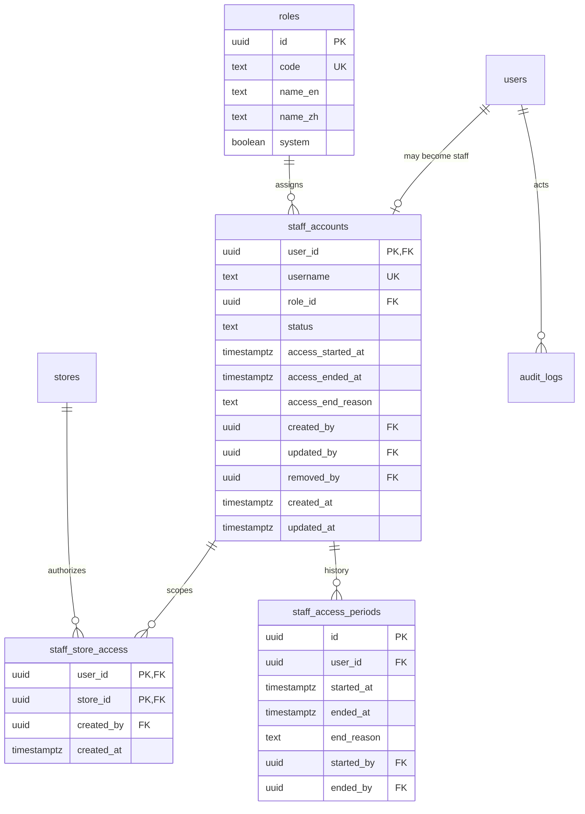

# 10 · Admin 门店角色与权限管理系统设计

状态：**已实施，待部署**
版本：Implemented v1 · 2026-08-12
适用范围：KIYOYO Admin Web、Cloud Run API、Cloud SQL PostgreSQL、Firebase Authentication / Identity Platform
时区：Africa/Nairobi

## 1. 目标与非目标

本设计在现有 Admin 中增加两种固定角色，并把门店范围作为后端强制执行的授权边界：

- `ADMIN`：拥有全部 Admin 权限；可以创建 `username + password` 后台用户、变更角色与门店授权、移除后台访问权，并可以为任意密码账号直接设置新密码。
- `OPERATOR`：由 Admin 创建并绑定一个或多个门店；可以完整处理授权门店订单和核销，并只读查看 Customer；不访问经营概览、Product、Coupon 或其他管理模块。
- 当前 dev 测试账号 `admin-dev@kiyoyo.test` 作为兼容登录名，在迁移后必须默认拥有 `ADMIN` 角色。新建后台账号不要求真实邮箱。账号密码继续只存在于 Identity Platform 和受控交付渠道，不写入数据库、Git 或本文档。

本期不做：

- 自定义角色或可编辑的 permission builder；角色模板固定为 `ADMIN` 和 `OPERATOR`。
- Operator 创建其他账号或给自己提权。
- 在 KIYOYO 数据库保存、读取或显示任何用户密码。
- 通过邮件发送后台账号邀请、邮箱验证或密码重置链接；账号密码由 Admin 直接设置并通过受控渠道交付。
- 仅依靠前端隐藏按钮来实现安全控制。
- Operator 修改门店、商品、标签、优惠券、客户资料或客户券。

固定角色优先于自定义 RBAC，可以让权限规则可审计、可测试，也避免 Admin 误配出不可预期的权限组合。未来确有第三类角色时，再增加固定角色或升级为 permission-based RBAC。

## 2. 现状与差距

当前实现只有二元权限：

- `api/src/auth.ts` 通过 Firebase `admin` custom claim 或 `ADMIN_EMAILS` 白名单设置 `actor.isAdmin`。
- 所有 `/v1/admin/*` 路由统一使用 `requireAdmin`，Admin 能全部访问，其他账号全部拒绝。
- 当前数据库 migration 尚无实际 `roles`、后台账号或门店授权表；`docs/03-data-model.md` 中的 `roles + user_roles(store_id)` 仍是目标模型。
- Admin Web 登录后一次性请求 Product、Tag、Order、Customer、Coupon、Store 全部数据，没有按角色或门店裁剪。
- Order 列表前端按门店过滤，但 API 会先返回所有门店订单；这不是安全边界。
- Overview 内嵌订单状态修改；Customer 详情允许改资料、改状态、发券和撤券；Product/Coupon 列表直接展示写操作。Operator 上线前必须拆分 read/write 能力。

因此这不是“新增一个 Tab”即可完成的功能，必须同时完成数据库授权模型、API 强制鉴权、Identity Platform 账号操作、前端能力降级、审计和测试。

## 3. 权限模型

### 3.1 权限范围定义

- **Global**：可跨全部 Nairobi 门店访问。
- **Assigned stores**：只允许访问 `staff_store_access` 中当前有效的门店。
- **Viewer**：只读；不能通过隐藏入口、直接 API 调用或修改请求调用写接口。
- **Full access**：在限定门店范围内包含读取和本模块已定义的写操作，但不自动获得其他模块权限。
- **No access**：前端不显示入口；直接调用 API 返回 `403 FORBIDDEN`。访问不属于自己的门店实体时优先返回 `404 NOT_FOUND`，减少资源枚举。

### 3.2 页面级权限矩阵

| Admin 模块 | ADMIN | OPERATOR | Operator 范围与说明 |
| --- | --- | --- | --- |
| Overview | Full / Global | No access | Operator 的 Home 只显示当前任务入口，不加载经营概览或营收数据 |
| Orders | Full / Global | Full | 只列出、查看和更新已授权门店履约订单 |
| Redeem | Full / Global | Full | 只可验证和核销已授权门店 pickup token |
| Customers | Full / Global | Viewer / Global | 可只读查看全部 Customer；不能编辑、停用、发券、撤券或设置密码 |
| Products & Tags | Full / Global | No access | 只在 Admin 管理入口内显示 |
| Coupons | Full / Global | No access | 只在 Admin 管理入口内显示 |
| Stores | Full / Global | No management | Operator 只在上下文选择器看到已授权门店，不显示 Stores 管理 Tab |
| Admin / 权限管理 | Full / Global | No access | 仅 Admin 可见；管理后台账号、角色、门店授权和密码设置 |
| Audit logs | Viewer / Global | No access | Admin 只读查看敏感操作审计 |

### 3.3 动作级权限矩阵

| Permission code | ADMIN | OPERATOR | Scope |
| --- | :---: | :---: | --- |
| `overview.read` | ✓ | — | Admin global |
| `orders.read` | ✓ | ✓ | Admin global；Operator assigned stores |
| `orders.transition` | ✓ | ✓ | Admin global；Operator assigned stores |
| `redeem.verify` | ✓ | ✓ | Admin global；Operator assigned stores |
| `redeem.execute` | ✓ | ✓ | Admin global；Operator assigned stores |
| `customers.read` | ✓ | ✓ | Global；Operator viewer 不受门店 scope 限制 |
| `customers.write` | ✓ | — | Global |
| `customers.password_set` | ✓ | — | Global；仅 password provider 账号 |
| `products.read` | ✓ | — | Global |
| `products.write` | ✓ | — | Global |
| `products.publish` | ✓ | — | Global |
| `product_tags.write` | ✓ | — | Global |
| `coupons.read` | ✓ | — | Global |
| `coupons.write` | ✓ | — | Global |
| `coupons.publish` | ✓ | — | Global |
| `customer_coupons.issue` | ✓ | — | Global |
| `customer_coupons.revoke` | ✓ | — | Global |
| `stores.read` | ✓ | ✓ | Operator 仅授权门店的最小上下文资料 |
| `stores.write` | ✓ | — | Global |
| `access.read` | ✓ | — | Global |
| `access.create` | ✓ | — | Global |
| `access.update` | ✓ | — | Global |
| `access.remove` | ✓ | — | Global |
| `access.password_set` | ✓ | — | Global |
| `audit.read` | ✓ | — | Global |

`ADMIN` 的“全部权限”应由服务端角色模板解析，不在每个账号上复制一组可漂移的 permission rows。`OPERATOR` 同理使用固定模板，再叠加门店 scope。

### 3.4 重要业务规则

1. 一个后台账号任一时刻只能有一个有效角色，避免同时为 Admin 与 Operator。
2. `ADMIN` 不绑定门店，天然为 global scope。
3. `OPERATOR` 至少绑定一个有效门店，并允许一个 Operator 同时绑定多个门店，以支持区域经理或临时跨店支援。
4. 角色变更立即生效，以 Cloud SQL 为权限 source of truth，不等待 Firebase token 刷新。
5. 禁止 Admin 移除自己的 Admin 权限。后台账号不提供邮件找回密码；Admin 为其他账号设置密码，自己的密码通过已登录状态下的专用 Change password 操作更新。
6. 系统必须始终保留至少一个 `ACTIVE ADMIN`。此约束在数据库事务中加锁检查，防止两个并发请求同时删除最后的 Admin。
7. “删除后台用户”定义为移除后台访问权，不硬删 Identity、`users`、订单或审计记录。`staff_accounts` 保留权限生效时间、失效时间、操作者与原因；UI 文案使用“Remove Admin access / 移除后台权限”，避免误导。
8. 停用门店时，不自动删除 Operator 绑定；该授权显示为无效并阻止访问，Admin 必须重新分配或移除。

## 4. 数据模型

采用固定角色表、单角色后台账号表和多门店 scope 表：



建议 migration 新增：

```sql
create table roles (
  id uuid primary key default gen_random_uuid(),
  code text not null unique check (code in ('ADMIN', 'OPERATOR')),
  name_en text not null,
  name_zh text not null,
  system boolean not null default true,
  created_at timestamptz not null default now()
);

create table staff_accounts (
  user_id uuid primary key references users(id) on delete restrict,
  username text not null,
  role_id uuid not null references roles(id) on delete restrict,
  status text not null default 'ACTIVE' check (status in ('ACTIVE', 'REMOVED')),
  access_started_at timestamptz not null default now(),
  access_ended_at timestamptz,
  access_end_reason text,
  created_by uuid references users(id),
  updated_by uuid references users(id),
  removed_by uuid references users(id),
  created_at timestamptz not null default now(),
  updated_at timestamptz not null default now()
);

create unique index staff_accounts_username_unique
  on staff_accounts(lower(username));

create table staff_access_periods (
  id uuid primary key default gen_random_uuid(),
  user_id uuid not null references staff_accounts(user_id) on delete restrict,
  started_at timestamptz not null default now(),
  ended_at timestamptz,
  end_reason text,
  started_by uuid references users(id),
  ended_by uuid references users(id),
  created_at timestamptz not null default now(),
  check (
    (ended_at is null and end_reason is null and ended_by is null)
    or (ended_at is not null and end_reason is not null and ended_by is not null)
  )
);

create unique index staff_access_periods_one_active
  on staff_access_periods(user_id) where ended_at is null;

create table staff_store_access (
  user_id uuid not null references staff_accounts(user_id) on delete cascade,
  store_id uuid not null references stores(id) on delete restrict,
  created_by uuid references users(id),
  created_at timestamptz not null default now(),
  primary key (user_id, store_id)
);

create index staff_store_access_store_idx
  on staff_store_access(store_id, user_id);
```

角色与 scope 的跨表规则由单一 service transaction 保证：Admin 必须为零条 store access；Operator 必须至少一条。每次角色更新在一个事务中锁定 `staff_accounts`、替换门店 scope、检查最后一个 Admin、写审计。

移除访问权时不执行 `DELETE`：将 `staff_accounts.status` 更新为 `REMOVED`，写入当前 `staff_access_periods` 的 `ended_at`、`end_reason`、`ended_by`，并同步当前快照字段和不可变 audit log。恢复权限时插入一条新的 access period。这样每一次生效/失效区间都有结构化记录，不会因恢复权限而覆盖历史。

### 4.1 测试 Admin 回填

安全迁移顺序：

1. Migration 只创建表并 seed 固定角色，不直接写密码。
2. 部署双读鉴权：数据库角色优先；迁移窗口内允许现有 Firebase `admin` claim / `ADMIN_EMAILS` 作为 legacy Admin fallback。
3. `/v1/auth/bootstrap` 对 legacy Admin 幂等创建 `staff_accounts(ADMIN)`；`admin-dev@kiyoyo.test` 首次登录后自动回填。
4. 用只读检查确认 dev 测试账号和至少一个 Owner 账号均为 Active Admin。
5. 移除生产 `ADMIN_EMAILS` fallback；Firebase claim 只作为 break-glass 迁移工具，不再是日常授权来源。

## 5. 后端授权设计

### 5.1 Actor 与中间件

`request.actor` 从当前 `isAdmin` 扩展为：

```ts
type Actor = {
  authId: string;
  userId: string;
  username: string | null;
  email: string | null;
  emailVerified: boolean; // 保留 Identity 元数据，不作为后台账号邮件流程
  accountStatus: "ACTIVE" | "SUSPENDED" | "DELETED";
  staff: null | {
    role: "ADMIN" | "OPERATOR";
    status: "ACTIVE" | "REMOVED";
    storeIds: string[];
    permissions: PermissionCode[];
  };
};
```

中间件拆为：

- `requireProfile`：有效 KIYOYO 用户。
- `requireStaff`：有效且处于 `ACTIVE` 生效周期的后台账号；后台账号不依赖真实邮箱、邮件验证或邮件恢复流程。
- `requirePermission(code)`：检查动作权限。
- `requireStoreScope(resolveStoreId)`：Admin 直接通过；Operator 必须包含目标门店。
- `requireRecentAdminAuth`：账号/角色/密码等敏感操作要求 `auth_time` 在 5 分钟内；后续生产启用 MFA 后同时要求 MFA claim。

权限判定只在 API 服务端完成。前端返回的 role、permission、store IDs 只用于展示，不作为后端可信输入。

### 5.2 门店隔离原则

- 列表查询：API 根据 actor scope 注入 SQL 条件，绝不先返回全量再由前端过滤。
- 单实体读取/写入：从数据库实体关系解析真实 `store_id`，不信任请求 body 中自报的门店。
- Orders：通过 `fulfillment_groups.store_id` 限制读取与状态流转。
- Redeem：先检查请求门店属于 actor，再在同一事务中验证 token 所属门店和核销状态。
- Overview：仅 Admin 可访问 Nairobi 全局经营统计。Operator 不请求该 endpoint；门店员工 Home 只根据已授权的订单与 Customer 列表显示任务提示。
- Customers：Operator 具有全局 viewer 权限，列表与详情不受门店 scope 限制；所有 Customer 写操作仍只允许 Admin。
- Product/Coupon：仅 Admin 可读取和管理；Operator 直接调用 read endpoint 同样返回 `403 FORBIDDEN`。

### 5.3 API 设计

会话与上下文：

| Method | Endpoint | Permission | 说明 |
| --- | --- | --- | --- |
| `GET` | `/v1/admin/session` | `requireStaff` | 返回 role、permissions、授权门店和能力快照 |
| `GET` | `/v1/admin/overview` | `overview.read` | 服务端从 actor 注入门店 scope；忽略或拒绝未授权的 `store_id`，绝不返回全局结果给 Operator |
| `GET` | `/v1/admin/context/stores` | `stores.read` | Admin 全部门店；Operator 仅授权门店最小字段 |

权限管理，仅 Admin：

| Method | Endpoint | Permission | 说明 |
| --- | --- | --- | --- |
| `GET` | `/v1/admin/access/users` | `access.read` | 后台账号列表、角色、门店、状态、生效/失效时间、最近登录 |
| `POST` | `/v1/admin/access/users` | `access.create` | Admin 直接创建 username/password 后台账号并分配角色 |
| `PATCH` | `/v1/admin/access/users/:userId` | `access.update` | 改角色、门店 scope、状态 |
| `DELETE` | `/v1/admin/access/users/:userId` | `access.remove` | 软移除后台访问权，写入失效时间、操作者和原因，保留账号与历史 |
| `POST` | `/v1/admin/users/:userId/password` | `access.password_set` 或 `customers.password_set` | Admin 直接设置新密码并撤销目标账号的旧会话；不发送邮件 |
| `GET` | `/v1/admin/audit-logs` | `audit.read` | 审计查询 |

现有 endpoint 按动作替换 `requireAdmin`：

- Product GET → `products.read`；Product/Tag POST/PATCH/DELETE/upload/publish → 对应 write/publish。
- Coupon GET → `coupons.read`；编辑和生命周期动作 → write/publish。
- Customer GET → `customers.read`；PATCH → `customers.write`；发券/撤券 → 独立权限。
- Order GET/transition → `orders.read` / `orders.transition` 并强制 store scope。
- Pickup verify/redeem → 对应 redeem 权限并强制 store scope。
- Store GET/PATCH → `stores.read` / `stores.write`；Operator 使用 context endpoint，不复用管理列表。

统一错误：

- `401 UNAUTHENTICATED`：无有效身份。
- `403 STAFF_ACCESS_REQUIRED`：不是有效后台账号。
- `403 PERMISSION_DENIED`：角色无动作权限。
- `404 NOT_FOUND`：实体不存在或不在 actor 门店范围内。
- `409 LAST_ADMIN_REQUIRED`：将导致系统没有 Active Admin。
- `409 SELF_ACCESS_CHANGE_FORBIDDEN`：试图移除或降级自己的权限。
- `409 ROLE_SCOPE_INVALID`：Operator 未选门店，或 Admin 带门店 scope。
- `412 RECENT_AUTH_REQUIRED`：敏感操作前需重新认证。

### 5.4 创建账号的一致性

Identity Platform 与 PostgreSQL 无法组成单一分布式事务。创建流程使用可补偿编排：

1. 验证 Admin recent auth、唯一 username、Admin 指定的密码、角色和门店 scope。
2. 检查 `staff_accounts.username` 与 Identity Platform 映射是否已有账号。
3. 若新账号不存在，创建 Firebase password identity。由于 Firebase 客户端 password provider 内部要求 email 格式，服务端为 staff username 生成不可投递、不可编辑且不在 UI 展示的内部 identity alias；真实登录界面只接受 username，现有 `admin-dev@kiyoyo.test` 保留兼容路径。
4. 在数据库事务中 upsert `users`、创建 `staff_accounts`、写 store scopes 和 audit log。
5. 数据库失败时，仅对本请求刚创建且没有业务数据的 Firebase user 执行补偿删除；补偿失败记录高优先级告警，支持幂等重试。
6. API 使用 request id / idempotency key，避免重复点击创建两个身份。

已有客户账号被升级为后台账号时不创建第二个 identity，直接复用同一 `users` 记录并增加 `staff_accounts`。

## 6. 密码管理设计

“Admin 可以更改所有账号密码”实现为 **Admin 直接设置新密码**，不是读取旧密码，也不发送邮件：

1. 仅 `ADMIN` 可执行，且要求最近 5 分钟内重新认证；生产目标再加 MFA。
2. API 用 Firebase Admin SDK `updateUser(external_auth_id, { password })`；KIYOYO API、Cloud SQL、审计和日志都不持久化明文密码。
3. Admin 创建账号时必须填写 username、密码和确认密码；设置新密码时也必须输入并确认。密码至少 12 位，并满足项目强度规则。
4. 后台登录界面使用 username + password，不收集真实邮箱。Firebase 内部 identity alias 只用于兼容现有 password provider，不可投递，也不用于邀请、验证、找回密码或重置链接。
5. 新密码只存在于 Admin 当前输入控件和到 Identity Platform 的加密请求中；API 成功响应不回传密码，页面离开或成功后立即清空字段。
6. 设置后调用 `revokeRefreshTokens`。Admin 直接交付最终密码，因此不设置 `must_change_password`，也不增加邮件或首次登录改密 gate。
7. 所有账号，包括 Customer，都不提供邮件密码重置入口；忘记密码时由 Admin 核验身份后直接设置新密码，并强制填写 reason。
8. 对 Google-only 账号，只有在业务明确要求启用密码登录时，Admin 才可通过独立的“Enable password login”高风险操作设置密码；不能由普通 reset 操作静默增加 provider。
9. 审计只记录 actor、target、时间、reason、session revoke 结果和 request id，绝不记录新密码。

## 7. Admin Web 设计

### 7.1 登录与初始化

登录成功后的顺序调整为：

1. 调用 `/v1/auth/bootstrap`。
2. 调用 `/v1/admin/session` 获取 role、permissions、stores。
3. 根据允许的 Tab 按需加载数据，不再启动时一次请求全部 Admin 数据。
4. 登录完成或权限变化后导航到 Home；无权限的管理模块不加载数据。

Home 与导航：

- 登录后先进入 Home，显示大尺寸任务入口。
- `ADMIN`：Redeem、Orders、Customers、**Admin**；Admin 内再进入 Overview、Products、Coupons、Stores、Users & access。
- `OPERATOR`：Redeem、Orders、Customers；不显示 Admin，也不加载 Overview、Products、Coupons 数据。
- Operator 顶部显示固定的门店 scope chip；多店 Operator 可在“全部已授权门店 / 单店”间切换，不能看到未授权门店名称。
- 账号区明确显示 `Admin` 或 `Operator · Westlands +1`，不再固定写 `Nairobi HQ`。

### 7.2 Admin / 权限管理 Tab

页面以可扫描表格为主：

| 列 | 内容 |
| --- | --- |
| User | Username、显示名、头像缩写；兼容账号可显示原登录名 |
| Role | Admin / Operator status chip |
| Store access | All stores 或门店 chips；过多时显示 `+N` |
| Account state | Active / Access removed；同时显示 Access started / Access ended |
| Last sign-in | Identity Platform metadata；无记录显示 Never |
| Updated | 操作者与 Africa/Nairobi 时间 |
| Actions | Edit access、Set password、Remove access |

工具栏包括 search、role filter、store filter、status filter 和 `+ New user`。Routine 操作使用中性按钮；主按钮只用于新建；移除权限和设置密码使用明确的警告样式。红色不用于普通 viewer 状态。

### 7.3 新建 / 编辑账号

桌面使用单层宽 dialog 或 side sheet；390 px 移动端使用独立全高页面，避免嵌套 modal。字段：

- Username / 用户名（必填、全局唯一，创建后不可修改；不要求邮箱）。
- Display name / 显示名。
- Role：Admin / Operator，附完整能力摘要。
- Stores：仅 Operator 显示，至少一个；支持搜索和多选。
- Password / 密码与 Confirm password / 确认密码：由 Admin 直接设置；显示强度规则和显隐控制，不提供邮箱字段、邮件邀请或重置入口。

Role 变化前显示影响摘要，例如：“Changing to Operator removes access to Overview, Products, Coupons, Stores and staff management. Customer access becomes view-only and operations are limited to Westlands.” Admin → Operator 时必须先选择门店；Operator → Admin 时清空 store scope。

### 7.4 Viewer 状态

- Operator 不渲染或请求 Overview、Products、Coupons、Stores 管理和权限管理模块。
- Customers：Operator 可全局只读查看详情，不受门店 scope 限制；对 Operator 隐藏 Save、状态选择、Issue/Revoke coupon、Set password。Admin 仍可使用完整 Customer 操作并直接设置密码。
- 禁止只把按钮 `disabled` 后仍连接写 handler；无权限时组件不接收写 callback，API 仍独立拒绝。

### 7.5 安全交互与完整状态

- Role 变更、移除权限、恢复权限、设置密码均显示目标账号、影响范围和明确确认文案。移除权限必须填写 reason，并在确认框显示即将写入的失效时间。
- 禁止自我降级/删除和最后一个 Admin 操作时，按钮 disabled 并显示原因；后端仍检查并发条件。
- 异步按钮防重复提交，保持宽度稳定；成功后显示下一步，失败保留输入并给出恢复方式。
- 覆盖 loading、empty、filtered-empty、403 access changed、409 conflict、network timeout、partial Identity/DB failure 和 success。
- Dialog 支持 Escape、焦点圈定、关闭后返回触发器；所有控件至少 44×44 px，状态不只靠颜色。
- 新增长期文案提供 English / Chinese 两套 copy；Admin 页面本期可以继续默认英文，但中文切换时不得溢出。
- 验证 390、768、1280、1440 px 和 200% zoom；移动端表格改为优先级 card/list，不横向压缩所有列。

## 8. 审计与安全

必须记录以下事件：

- `STAFF_USER_CREATED`
- `STAFF_ROLE_CHANGED`
- `STAFF_STORE_SCOPE_CHANGED`
- `STAFF_ACCESS_RESTORED`
- `STAFF_ACCESS_REMOVED`
- `USER_PASSWORD_SET_BY_ADMIN`
- `USER_SESSIONS_REVOKED`
- `LEGACY_ADMIN_BACKFILLED`
- `PERMISSION_DENIED`（聚合/采样，避免日志洪水）

审计 metadata 允许包含 before/after role、before/after store IDs、reason、Identity uid hash 或非敏感标识；不得包含密码、ID token、完整 pickup token 或不必要的客户 PII。

额外安全要求：

- 权限管理和密码设置限流；短时间为多个账号设置密码时触发告警。
- Admin session 使用较短空闲超时；敏感操作 recent auth，生产目标启用 MFA。
- 所有用户列表默认分页，搜索做长度限制和参数化查询。
- 角色变化不依赖前端缓存；API 每次请求从 DB 读取，后续若加缓存必须有短 TTL 和主动失效。
- API 验证 Firebase revoked tokens，至少覆盖 Admin/Operator 管理接口。
- Out-of-scope 订单、customer、fulfillment 和 pickup 不泄露其是否存在。

## 9. 测试与验收

### 9.1 表驱动权限测试

对每个 permission code 至少覆盖 `ADMIN`、授权门店 Operator、未授权门店 Operator、普通 Customer、Removed Staff：

- Admin 全部允许。
- Operator 只允许矩阵中 read/full 动作。
- Operator 可以读取全局 Customer 列表和详情；直接 HTTP 调用 Overview、Product、Coupon 或 Customer 写接口均返回 403。
- Operator 的订单列表不含其他门店；用已知 fulfillment id 也不能跨店 transition。
- Operator 不能用自己授权门店参数核销其他门店 token，也不能伪造 body `store_id` 绕过。
- Operator 的 Customer 列表和详情为全局只读；首页不请求或显示经营指标。

### 9.2 账号与角色测试

- 创建 Admin、创建单店和多店 Operator；重复提交幂等。
- 已有 Customer 升级为 Operator 不生成重复用户。
- Operator → Admin 清理 store scope；Admin → Operator 未选店返回 409/422。
- 自我降级或移除权限失败；并发移除最后两个 Admin 时至少保留一个。
- Removed Staff 的已有 token 立即失去 Admin API 访问；列表保留 access started/ended、removed by 和 reason。
- `admin-dev@kiyoyo.test` 迁移后是 Active Admin，且 regression login 成功。
- Identity 创建成功但 DB 失败时执行补偿并产生可运维记录。

### 9.3 密码测试

- Admin 能为 password provider 账号直接设置新密码；Operator 与 Customer 不能。
- 创建与设置密码均要求输入确认值并执行至少 12 位及强度校验。
- OAuth-only 账号不被普通 Set password 操作静默增加 provider。
- 设置后旧 refresh token 被撤销，旧 session 不能继续访问敏感 API。
- 新密码、请求 body 和错误响应不进入日志或 audit metadata，成功后前端立即清空密码字段。
- 系统不调用或展示任何邮件邀请、验证、找回或 password-reset link 流程。

### 9.4 UI 与可访问性

- Operator 只显示 Home、Orders、Redeem、Customers；刷新或手输不可访问 tab 时安全回退。
- Operator 无 Product/Coupon/Overview 请求，Customer viewer 无写控件。
- Store selector 只含授权门店。
- 键盘完成新建、编辑、确认和取消；焦点可见并正确返回。
- English/Chinese、empty/error/loading/disabled/success 在四个基线宽度正常。
- lint、typecheck、API unit/integration、Web render tests 和 build 全部通过。

## 10. 实施顺序与回滚

为避免锁死现有 Admin，按以下小步发布：

1. **Schema 扩展**：新增固定 roles、staff accounts/scopes 和索引；不修改现有行为。
2. **双读身份**：实现 DB staff actor、legacy Admin fallback、Admin session endpoint；回填 dev Admin。
3. **API 权限拆分**：先为所有 GET 加权限，再为每个写路由加动作权限和门店 scope；补集成测试。
4. **Access API**：账号创建、角色和门店变更、软移除/恢复、密码设置、recent auth、审计。
5. **Admin Web**：先读取 session 和按需加载，再增加 viewer 模式和 Admin Tab。
6. **强制切换**：确认所有 Admin 已回填后，移除 production legacy email/claim fallback。
7. **安全加固**：MFA、空闲超时、权限告警和完整 E2E。

每一步保持数据库向后兼容。回滚代码时保留新增表，不做破坏性 down migration；恢复 legacy fallback 仅用于受控紧急回滚并记录告警。

## 11. 已批准的 Review 决策

2026-08-12 已确认：

1. **Operator 门店数量**：允许一个 Operator 绑定一个或多个门店。
2. **Customer viewer 范围**：Operator 可全局只读查看所有 Customer，不受门店 scope 限制；不授予 Overview 经营统计权限。
3. **移除访问语义**：软移除后台访问权，不删除 Identity 或业务账号；保留权限生效时间、失效时间、操作者、原因和完整审计。
4. **密码管理**：所有密码由 Admin 直接设置，不使用邮件邀请、验证、找回或重置流程。
5. **门店员工首页**（2026-08-13）：Operator 只使用 Redeem、Orders 和只读 Customers；产品、优惠券、经营概览、门店管理和权限管理均归入 Admin 入口。

设计 Review 已通过，并已按本文档完成代码、迁移、权限契约测试与前端回归验证；云端迁移和部署不在本次提交范围内。
