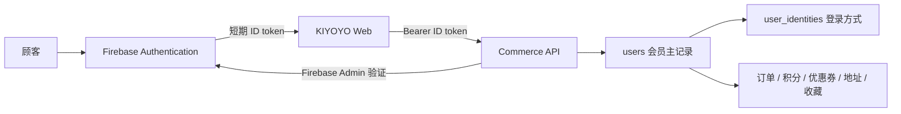

# KIYOYO 用户登录模块设计与实施说明

状态：已实施

最后更新：2026-08-27

适用范围：顾客 Web、Commerce API、Cloud SQL、Firebase Authentication / Google Cloud Identity Platform

## 1. 目标与结论

KIYOYO 顾客账号统一使用 Firebase Authentication 处理身份凭据，KIYOYO API 只接受 Firebase Admin SDK 验证后的身份，并维护会员、订单、积分、优惠券、地址和收藏等业务数据。

当前支持：

- 邮箱 + 密码注册和登录；
- Google 登录；
- 忘记密码和安全重置；
- 邮箱密码注册和密码重置；顾客会员不要求邮箱验证；
- 注册/首次登录后通过 SMS 验证并绑定唯一肯尼亚手机号；
- 同一 Firebase 用户关联多种登录方式；
- 防止移除最后一种登录方式；
- 未完成手机号验证的账号保持 Pending 会员状态，可浏览和维护购物车，但不能提交结账；
- 登录时把游客收藏并入会员收藏，保留本地购物车和结账返回状态；
- 停用会员在 API 层被统一拒绝。

KIYOYO 数据库不保存密码、密码哈希、Firebase refresh token、Google OAuth token 或 OAuth Secret。

## 2. 技术选择

| 层级 | 技术 | 职责 |
| --- | --- | --- |
| 浏览器身份 | Firebase Authentication Web SDK | 注册、登录、OAuth 弹窗/重定向、SMS 手机验证、账号关联、会话持久化 |
| API 身份校验 | Firebase Admin SDK | 验证 ID token，从可信 claims 读取 uid、email、email_verified、phone_number 和 provider identities |
| Web 应用 | Next.js / React / TypeScript | 双语登录 UI、会话 hook、验证 gate、状态恢复 |
| API | Fastify / TypeScript / Zod | bootstrap、账号状态和 verified-membership middleware、兼容响应 |
| 业务数据库 | PostgreSQL / Cloud SQL | 会员主记录、唯一 E.164 手机号和 provider identity 映射，不保存第三方凭据 |
| 基础设施 | Terraform + Firebase / Identity Platform 控制台 | 项目、Web App、授权域名、邮件/手机登录、肯尼亚 SMS allowlist 和运行环境 |

选择 Firebase/Identity Platform 的主要原因是：已有 GCP/Firebase 基础设施；三种登录方式使用同一 token 校验链路；密码和 OAuth 凭据不进入 KIYOYO 系统；密码重置和 provider linking 可使用成熟 SDK。

## 3. 模块边界

```text
web/app/auth/
  firebase.ts          Firebase 初始化
  service.ts           Firebase SDK 操作和账号关联
  phone.ts             肯尼亚手机号规范化与脱敏展示
  errors.ts            SDK 错误到稳定业务错误码
  types.ts             会话、provider、状态类型
  useCustomerAuth.ts   会话监听、bootstrap、pending action

web/app/components/customer/auth/
  AuthDialog.tsx       登录、注册、找回密码入口
  PasswordFields.tsx   密码输入、显示和确认
  PhoneVerificationGate.tsx SMS 验证和会员激活 gate
  ProviderManager.tsx  登录方式关联/移除

web/app/auth/action/page.tsx
  历史邮箱验证链接与密码重置 action handler

api/src/modules/auth/
  routes.ts            HTTP、Zod 和兼容响应
  schemas.ts           请求 schema
  service.ts           bootstrap 业务编排
  repository.ts        用户及 identity SQL
  middleware.ts        token、状态和手机会员验证 gate
  types.ts             服务端身份类型
```

`KiyoyoApp` 只消费 `useCustomerAuth()` 暴露的状态和动作；Account 页面只接收属性和回调，不直接导入 Firebase。`platform.ts` 保留带 ID token 的通用 transport 和非认证业务 API 映射。

## 4. 身份与业务账号关系



Firebase `uid` 是身份真相来源，`users.id` 是 KIYOYO 业务主键。Google 和密码登录关联到同一 Firebase 用户后，只产生一个 `users` 会员记录，因此不会复制订单、积分或优惠券账户。

请求体中的 `email`、`phone` 或 `provider` 不参与授权；API 只读取 Firebase Admin SDK 验证后的 claims。配送地址里的联系电话是履约数据，不能充当会员认证号码。

## 5. 数据模型

### 5.1 `users` 扩展字段

| 字段 | 类型 | 用途 |
| --- | --- | --- |
| `external_auth_id` | text, unique | Firebase uid；继续兼容原有 bootstrap |
| `email` | text | 最近一次可信 token 中的邮箱 |
| `email_verified_at` | timestamptz, nullable | 当前邮箱已验证的时间；未验证时为空 |
| `phone_e164` | text, nullable, unique | 最近一次可信 token 中的 E.164 手机号；一个号码只能属于一个会员 |
| `phone_verified_at` | timestamptz, nullable | 当前手机号完成 Firebase SMS 验证的时间；与 `phone_e164` 同为空或同为非空 |
| `last_login_at` | timestamptz | 最近一次 bootstrap 时间 |
| `status` | text | `ACTIVE`、`SUSPENDED`、`DELETED` |

保留旧 `auth_provider` 字段用于向后兼容；稳定运行后再单独迁移和清理。

### 5.2 `user_identities`

| 字段 | 类型 | 说明 |
| --- | --- | --- |
| `id` | uuid | identity 记录主键 |
| `user_id` | uuid FK | 指向 `users.id`，会员删除时级联 |
| `provider` | text | 约束预留 `PASSWORD`、`GOOGLE`；当前只同步可信的 Google identity |
| `provider_subject` | text | Firebase token 中对应 social provider 的可信 subject |
| `linked_at` | timestamptz | 首次关联时间 |
| `last_seen_at` | timestamptz | 最近一次 bootstrap 看见时间 |
| `unlinked_at` | timestamptz, nullable | 解除关联时间；为空表示有效 |

约束：

- 同一会员同一时间每种 provider 只能有一个有效 identity；
- 同一 provider subject 同一时间只能属于一个会员；
- identity 已属于其他会员时整个 bootstrap 事务失败，禁止静默转移 `user_id`；
- 解除关联使用 `unlinked_at` 留审计轨迹，不物理删除；
- migration 只增加字段和表，不删除旧结构。

通用 `firebase.identities.email` 只表示账号带邮箱，不表示账号设置了密码，因此不能映射为 `PASSWORD`。密码登录方式是否存在由浏览器 Firebase User 的 `providerData` 展示，KIYOYO 数据库不持久化密码 identity。

## 6. 核心流程

### 6.1 邮箱注册

1. 前端校验邮箱、密码确认和项目密码策略。
2. Firebase 创建身份，不发送验证邮件。
3. Web 取得 ID token，调用 `POST /v1/auth/bootstrap`。
4. API 从 token 同步 uid、邮箱、验证状态和可信的 social provider identities。
5. Web 要求用户继续完成 SMS 手机验证；未完成前账号显示为 Pending 会员。
6. 用户可继续浏览、收藏和维护购物车；结账前只要求验证手机号，不要求验证邮箱。

密码仅从浏览器发送给 Google Identity Toolkit，不经过 KIYOYO API。

### 6.2 Google 登录

优先使用 popup；浏览器阻止 popup 时回退到 redirect。用户取消、网络故障、provider 未启用和账号冲突均映射成稳定的中英文业务错误。

如果 Firebase 返回“同邮箱已有其他登录方式”，用户先使用已有方式进入同一账号，再从 Account security 关联新 provider。关联完成后强制刷新 token 并重新 bootstrap。

### 6.3 手机号验证和强绑定

Web 将肯尼亚本地号码规范化为 E.164（例如 `0712 345 678` → `+254712345678`），通过 Firebase `RecaptchaVerifier` 和 `linkWithPhoneNumber` 向当前 Firebase uid 关联 Phone Credential。验证码只提交给 Firebase，不经过 KIYOYO API。

验证码成功后强制刷新 ID token，再调用 bootstrap。API 只接受 token 的 `phone_number`，同步到 `users.phone_e164`；数据库格式约束和唯一索引提供第二层保护。号码已属于其他 Firebase 账号时必须阻止绑定并进入原账号登录/人工恢复流程，禁止自动覆盖或只按号码合并业务数据。

### 6.4 忘记密码

找回页面始终显示相同成功文案：“如果账号存在，重置邮件已发送”，避免泄露邮箱是否注册。`/auth/action` 校验 action code、要求新密码并处理过期、无效或已使用链接。

### 6.5 手机号验证和结账恢复

前端在开始结账时检查 `phoneVerified`；API 在 `POST /v1/checkouts` 再次执行 `requireVerifiedMembership`。未验证时返回稳定错误码 `PHONE_VERIFICATION_REQUIRED`。`emailVerified` 继续作为 Identity 元数据返回和保存，但不参与顾客会员激活或结账授权。

验证完成后，Web reload Firebase 用户并强制刷新 ID token，再 bootstrap。购物车、门店、语言、游客收藏和 pending checkout 不被清空，用户可回到原结账流程。API bootstrap 暂时失败时进入独立错误状态，不按“已登出”清除本地订单兜底数据。

### 6.6 登录方式管理

Account security 展示两种 provider。用户可增加 Google 或密码方式；只有存在至少两种有效方式时才允许移除。页面不直接调用 Firebase SDK，所有动作通过 auth hook 完成。账号冲突不会跨对话框暂存 OAuth credential；用户使用原方式登录后，再从 Account security 主动关联新方式。

本地收藏带有 `guest` 或 `member:<id>` owner。只有明确标记为 `guest` 的收藏会在登录时合并一次；其他会员或未知旧缓存不会上传到当前账号。真实 Firebase 登出会清理会员收藏缓存并切回 guest owner。

## 7. API 契约

原路径保持不变：

```http
POST /v1/auth/bootstrap
Authorization: Bearer <firebase-id-token>
Content-Type: application/json

{"nickname":"KIYOYO Member","locale":"zh"}
```

响应采用向后兼容扩展：

```json
{
  "data": {
    "id": "business-member-uuid",
    "status": "ACTIVE"
  },
  "auth": {
    "uid": "firebase-uid",
    "emailVerified": true,
    "phoneNumber": "+254712345678",
    "phoneVerified": true,
    "membershipReady": true,
    "providers": ["GOOGLE"]
  },
  "permissions": {
    "admin": false
  }
}
```

受保护请求使用短期 Firebase ID token。API 不接受 refresh token，也不从请求体相信用户邮箱、provider 或 uid。`auth.providers` 是 API 从 token 同步到业务库的 social identities，不作为 Account 页面完整登录方式列表；完整列表由 Firebase SDK `providerData` 提供。

## 8. 安全规则

- Firebase 本地会话持久化由 SDK 管理，不创建自定义长期 session localStorage；旧 `kiyoyo-session` 会被清除。
- 生产环境应启用 email enumeration protection；官方建议所有项目开启。
- Phone provider 只允许 `KE` 区域；Web 使用 Firebase reCAPTCHA，监控发送/验证比率和异常费用，真实短信仅在 Blaze 方案发送。
- 密码最少 10 个字符，允许密码管理器粘贴；服务端策略需在 Identity Platform 设置为 enforce。
- 重置密码文案不披露账号存在性。
- Admin 邮箱 allowlist 只在 token 的邮箱已验证时生效。
- SUSPENDED/DELETED 账号由 API middleware 拒绝。
- OAuth Secret 只保存在 provider 控制台或 Secret Manager，不写入 Git、Terraform `.tfvars`、Terraform state、数据库或日志。
- 日志只记录请求 ID、业务错误码和 Firebase uid 的必要诊断信息，不记录密码、token 或 provider credential。

## 9. Firebase / OAuth 上线配置

Terraform 已管理 Firebase 项目、Web App、邮箱密码登录和授权域名。Google 的 OAuth Secret 不由当前 Terraform 资源管理，因为该资源会把 `client_secret` 以明文保存进 state。

每个环境按以下清单配置：

1. Firebase Authentication → Sign-in method：启用 Email/Password、Google 与 Phone。
2. Authentication → Settings：加入正式 Web 域名和预览域名；移除不再使用的域名。
3. SMS region policy 仅允许肯尼亚 `KE`，并启用 email enumeration protection。
4. Password policy：enforce，最少 10 字符；已有用户迁移阶段不强制升级旧密码。
5. Email templates：设置发件人、品牌文案，并把验证/重置 Action URL 指向正式站点 `/auth/action`。
6. Google OAuth consent screen 切换生产状态前，完成域名验证、隐私政策与必要审核。

相关官方资料：

- [Identity Platform 密码策略](https://cloud.google.com/identity-platform/docs/password-policy)
- [Email enumeration protection](https://cloud.google.com/identity-platform/docs/admin/email-enumeration-protection)
- [Firebase Google 登录](https://firebase.google.com/docs/auth/web/google-signin)
- [Firebase Web 手机认证](https://firebase.google.com/docs/auth/web/phone-auth)
- [Firebase 自定义邮件 action handler](https://firebase.google.com/docs/auth/custom-email-handler)

## 10. 成本

根据 [Google Cloud Identity Platform 官方价格](https://cloud.google.com/identity-platform/pricing)，邮箱和 social provider 属于 Tier 1，按月活跃用户（MAU）计费；未登录的存量账号不计 MAU。2026-08-12 的公开价格为：前 50,000 MAU 免费，50,000–100,000 部分每 MAU USD 0.0055，100,000–1,000,000 部分每 MAU USD 0.0046，之后继续按阶梯下降。价格会变化，上线预算应以当期官方页面为准。

| 月活跃用户 | 认证服务估算/月 |
| ---: | ---: |
| 10,000 | USD 0 |
| 50,000 | USD 0 |
| 75,000 | 约 USD 137.50 |
| 250,000 | 约 USD 965 |
| 1,000,000 | 约 USD 4,415 |

以上不包含 Cloud Run、Cloud SQL、网络流量、自定义邮件发送、SMS 和人工运维成本。肯尼亚验证短信按发送条数单独计费；2026-08-26 官方公开价为每条 USD 0.14、每天前 10 条免费，重发也计入发送量，预算必须以上线当期价格为准。Google provider 本身不会形成另一份 Identity Platform Tier 1 计费，但 Google 的审核、隐私材料和账号运营需要人力。

## 11. 测试与验收

自动化验证包含：

- Web ESLint、TypeScript、Vinext SSR/契约测试、Vinext build 和 Next production build；
- auth 模块边界、Google/password/phone provider、号码规范化、验证/重置 action、结账 gate、状态保留的契约测试；
- API TypeScript、provider claims 映射、bootstrap service、注入式路由、稳定错误码测试；
- migration 前向扩展、手机号格式/唯一性、provider 约束、有效 identity 唯一性契约；
- 仓库统一 `scripts/verify-refactor.sh`、Terraform format 和 Git whitespace。

人工/集成环境仍需使用 Firebase 测试号码验证：reCAPTCHA、正确/错误/过期验证码、重复号码冲突、短信重发限流；另需验证密码重置邮件投递、Google 取消与回调、同邮箱关联、停用用户，以及 390/768/1280/1440px 中英文键盘操作。自动化测试禁止发送真实短信。

## 12. 运维与回滚

- 发布顺序：数据库 migration → API → Identity Platform Phone provider 与 `KE` allowlist → Web → 受控测试号码验收 → 正式开放。
- API 和 Web 均兼容旧 bootstrap 路径及旧用户主表字段。
- 回滚 Web/API 不需要回滚 migration；新增列和 `user_identities` 可保留。
- 不执行向后 migration，不删除用户身份数据。
- provider 故障时可在 Firebase 控制台单独停用 Google，邮箱密码登录继续工作。
- 监控重点：登录失败率、bootstrap 5xx、`PHONE_VERIFICATION_REQUIRED` 比例、provider linking 冲突、密码重置发送失败和停用账号访问。
