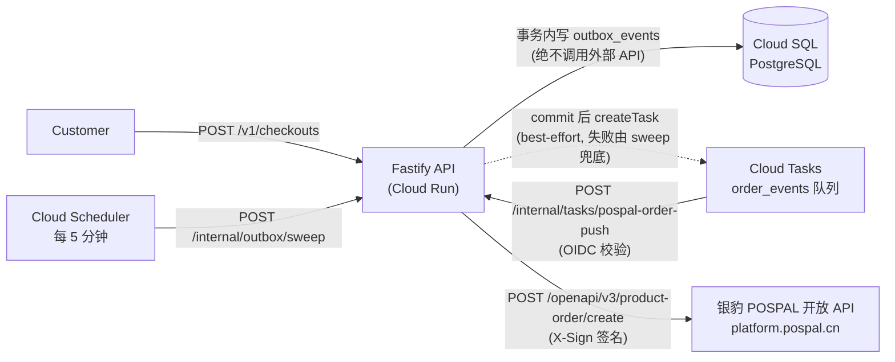
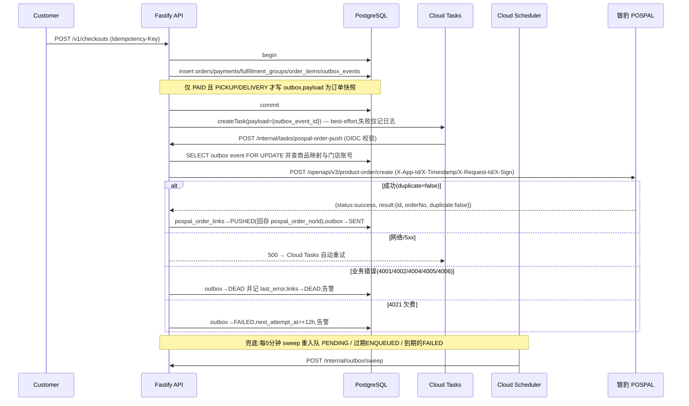

# 12 · 银豹 POSPAL 集成设计(已支付订单推送门店收银系统)

> 状态:设计稿,待 review。
> 本文档为**探索结论 + 系统设计**,不含实现代码。实现以本文档为蓝本,分 Phase 1(推单)与 Phase 2(状态回传)落地。
> 凭据来源:根目录 `.env`(account / appID / appKey / userArea=81区 / host)。

## 1. 目标与范围

KIYOYO 平台订单目前只停留在平台侧,门店收银系统(银豹 POS)看不到、无法履约。本次集成目标是:平台**已支付(PAID)且绑定门店**的订单,通过银豹开放 API 异步推送为银豹"网单",进入门店收银链路(厨打、履约、结账)。

**Phase 1(实现范围):**
- 已支付订单(PICKUP / DELIVERY,绑定门店)异步推送为银豹网单(`product-order/create`)
- 银豹商品字典同步,建立 KIYOYO 商品 ↔ 银豹商品映射(不靠名称兜底)
- 门店映射(store → 银豹门店账号)与验证
- 管理侧可见性与人工重试

**Phase 2(本文档设计,后续实现):**
- 银豹回调(`productOrder.change` / `ticket.change`)回传网单状态,驱动订单履约状态机
- `increment-page` 轮询兜底(回调丢失防御 + 漏推发现)

**明确不做的:** 库存同步、银豹会员(`customerNumber` 不传)、口味属性字典(定制写 item comment)、SHIPPING 订单(无门店,银豹推单按门店账号路由)。

---

## 2. 银豹开放 API 要点(探索结论)

来源:银豹开放平台文档 https://platform.pospal.cn/openapi-doc/ (对接说明 / 签名规则 / 计费规则 / 回调说明 等章节)。

### 2.1 认证与签名

无 accessToken 机制。每次请求携带 4 个自定义头 + 签名:

| 请求头 | 说明 |
|---|---|
| `X-App-Id` | 应用 ID(申请开放平台获得) |
| `X-Timestamp` | Unix 秒;平台要求与当前时间差 **≤ 5 分钟** |
| `X-Request-Id` | 同一 appId 下**必须唯一**(建议 UUID 或业务流水号) |
| `X-Sign` | 签名值,算法见下 |
| `Content-Type` | 固定 `application/json;charset=UTF-8` |

```
stringToSign = appId + "|" + requestId + "|" + timestamp + "|" + appKey
sign = md5(stringToSign).toUpperCase()      # 注意大写
```

签名示例(占位符,实现时可用真实凭据复算校验):

```
appId      = <POSPAL_APP_ID>
appKey     = <POSPAL_APP_KEY>
requestId  = 8f14e45f-ceea-4b28-aa04-94bf0a1c62e2
timestamp  = 1755075000

stringToSign = "<POSPAL_APP_ID>|8f14e45f-ceea-4b28-aa04-94bf0a1c62e2|1755075000|<POSPAL_APP_KEY>"
X-Sign       = md5(stringToSign).toUpperCase()
```

- 仅支持 `POST`,请求体 `application/json`,UTF-8。
- 平台校验:appId 可用性、timestamp 时效、requestId 唯一、签名正确。
- 请求体**必须含 `account`**(业务门店账号)。连锁场景用**总部 appId + 子门店 account** 操作各店数据;`user/page` 传总部 account 可一次拉取总部 + 全部子门店。

### 2.2 接口地址

- 正式环境唯一 API host:`https://platform.pospal.cn` + `/openapi/v3/...`(标准 443 端口,官方文档登记的域名)。
- ⚠️ **实测结论(2026-08-13)**:根 .env 中的"接口地址前缀 `https://area81-win.pospal.cn:443/`"是**控制台/门店端地址,不是开放 API 地址**——该 host 上 `/openapi/v3/*` 全部返回 404;`openapi.pospal.cn`/`openapi81.pospal.cn` 返回微服务异常(502)。**API 一律走 `platform.pospal.cn`**,与区域无关(区域由账号体系内部路由)。
- 无独立测试环境:控制台"接口调试"是真实调用、按标准计费;回调测试是模拟、不计费。

### 2.3 关键接口清单

| 接口 | 路径 | 计费 | 用途 |
|---|---|---|---|
| 新增网单 | `POST /openapi/v3/product-order/create` | 固定 200 Token | **Phase 1 推单核心** |
| 查询网单 | `POST /openapi/v3/product-order/increment-page` | 精准 100 / 范围 800(+扩展) | 幂等回拉、Phase 2 轮询 |
| 查询商品 | `POST /openapi/v3/product/increment-page` | 基础 100 + 扩展 20/项 | 商品字典同步 |
| 查询门店 | `POST /openapi/v3/user/page` | 固定 100 | 门店账号验证 |
| 回调:网单变更 | `productOrder.change` | 20/次 | Phase 2 状态回传 |
| 回调:销售单据 | `ticket.change` | 100/次 | Phase 2 审计 |

### 2.4 计费

- 10000 Token ≈ 1 元;首次登录控制台赠送 10000 Token;按 `X-App-Id` 归集,account 不作为计费依据。
- 业务量估算:150 单/天推网单 = 150 × 200 = 30000 Token/天 ≈ **3 元/天,约 90 元/月**;字典同步(每天一次,按商品页数)与轮询另有少量消耗。
- 欠费(错误码 4021):超过宽限期后暂停正式调用与正式回调。

### 2.5 错误码

| 错误码 | 含义 |
|---|---|
| 4001 | 请求参数错误(缺公共头、account 空、JSON 非法等) |
| 4002 | 无效的 appId |
| 4003 | 请求已过期,或时间范围不合法 |
| 4004 | 签名错误,或排序字段不合法 |
| 4005 | 无效的 account |
| 4006 | 没有目标门店的访问权限 |
| 4021 | 账号已欠费,正式服务已暂停 |
| 5000 / 5001 | 系统异常 / 请求上下文不存在 |

响应公共结构:`{"status": "success"|"error", "errorCode": 0|..., "messages": [...], "result": {...}}`;分页接口 result 含 `list` / `hasMore` / `nextLastId`(游标 = 当前页最后一条记录 id)。

### 2.6 关于"能否通过 API 查询门店 appKey"的结论

**不能。**

- `user/page`(查询门店)响应字段仅: `userId, account, number, email, address, tel, company, industry, secondIndustry, createdDatetime, enable, self` —— **不含任何 appId / appKey / secret 凭证字段**。
- 银豹的 appKey 是**应用级**凭据:一个 appId 对应一个 appKey,不是门店级。子门店只有在自行向开放平台申请独立 appId 时才有独立 appKey(不可通过 API 查询,只能在各自控制台看到)。
- 连锁场景(与我们的凭据形态一致:总部 account=mixuehq)使用**总部 appId + 请求体 `account` 指定门店**即可,无需门店级密钥。**不要尝试通过 API 获取门店密钥。**

---

## 3. 总体架构与推单时序

### 3.1 架构:Transactional Outbox + Cloud Tasks + Scheduler 兜底



**为什么选 Cloud Tasks 而非内置轮询 worker:**
1. Cloud Run `min_instance_count=0`(见 `infra/terraform/cloud_run.tf`),进程内 `setInterval` 在无流量的缩零实例上**根本不运行**,内置轮询 worker 不可靠;常驻实例违背仓库成本取向。
2. 队列已存在且配置合理:`infra/terraform/tasks.tf` 的 `order_events`(5 rps、5 次重试、5s→300s backoff)与 `docs/02-system-architecture.md` §异步可靠性的规划一致;`iam.tf` 已给 API SA 绑定 `roles/cloudtasks.enqueuer`。
3. 事件级重试:处理失败返回 5xx → Cloud Tasks 自动退避重试,无需自建退避逻辑。

需要**新增**的只有:Cloud Scheduler 清扫任务(补齐"commit 后 enqueue 失败 / enqueue 后实例崩溃"缝隙)+ 两个内部端点。

**关键约束:checkout 事务内只写 outbox 行,绝不调用外部 API;`createTask` 在 commit 之后 best-effort 执行(失败由 sweep 兜底)。**

### 3.2 内部端点与调用认证

| 端点 | 调用方 | 认证 |
|---|---|---|
| `POST /internal/tasks/pospal-order-push` | Cloud Tasks | OIDC token(`oidcToken.serviceAccountEmail` = API SA,audience = 服务 URL);`google-auth-library` `OAuth2Client.verifyIdToken` 校验 audience |
| `POST /internal/outbox/sweep` | Cloud Scheduler(每 5 分钟) | 同上 |
| `POST /v1/webhooks/pospal` | 银豹(Phase 2) | 回调签名(X-Sign,见 §9) |

新增 npm 依赖:`@google-cloud/tasks`(enqueue)、`google-auth-library`(OIDC 校验)。退路:校验 `X-CloudTasks-QueueName` / `X-CloudTasks-TaskName` 头(非安全边界,仅防误触,文档注明)。

### 3.3 推单时序



---

## 4. 数据模型(迁移 `0005_pospal.sql`)

```sql
-- 1) 通用 outbox(与 docs/02 规划一致,事件级投递)
create table outbox_events (
  id uuid primary key default gen_random_uuid(),
  aggregate_type text not null,          -- 'order'
  aggregate_id uuid not null,            -- orders.id
  event_type text not null,              -- 'pospal.order_created'
  payload_json jsonb not null,           -- 订单快照(见 §5.2)
  status text not null default 'PENDING'
    check (status in ('PENDING','ENQUEUED','SENT','FAILED','DEAD')),
  attempts integer not null default 0,
  last_error text,
  next_attempt_at timestamptz not null default now(),
  created_at timestamptz not null default now(),
  updated_at timestamptz not null default now()
);
create unique index outbox_pospal_order_unique
  on outbox_events(aggregate_id) where event_type='pospal.order_created';
create index outbox_sweep_idx on outbox_events(status, next_attempt_at)
  where status in ('PENDING','FAILED');
-- ENQUEUED 超时(updated_at < now()-2h)的拾取:普通索引 + 查询时过滤

-- 2) 银豹推单状态(运营事实表,Phase 2 回传也写这里)
create table pospal_order_links (
  id uuid primary key default gen_random_uuid(),
  order_id uuid not null unique references orders(id),
  store_id uuid not null references stores(id),
  pospal_account text not null,          -- 推送时快照的门店银豹账号
  kiyoyo_order_no text not null,         -- = orders.order_number
  pospal_order_no text,                  -- 银豹返回/回传匹配键(Phase 1 恒等于 kiyoyo_order_no)
  pospal_order_id text,                  -- 银豹返回 id
  state text,                            -- 银豹 state 码(Phase 2 更新)
  status text not null default 'PENDING'
    check (status in ('PENDING','PUSHED','FAILED','DEAD',
                      'CONFIRMED','PREPARING','READY','COMPLETED','CANCELLED')),
  last_error text,
  last_synced_at timestamptz,
  created_at timestamptz not null default now(),
  updated_at timestamptz not null default now()
);
create index pospal_links_status_idx on pospal_order_links(status, updated_at);

-- 3) 商品字典映射(kiyoyo product ↔ 银豹商品)
create table pospal_product_mappings (
  id uuid primary key default gen_random_uuid(),
  product_id uuid references products(id) on delete cascade,  -- null = 银豹有、KIYOYO 未匹配
  pospal_uid text not null unique,        -- 银豹商品 uid
  pospal_barcode text not null,
  pospal_name text not null,
  pospal_sell_price_cents integer not null,  -- 银豹售价(分),用于对账/告警
  source text not null default 'AUTO' check (source in ('AUTO','MANUAL')),
  status text not null default 'ACTIVE' check (status in ('ACTIVE','DISABLED')),
  last_synced_at timestamptz not null default now(),
  created_at timestamptz not null default now()
);
create unique index pospal_mapping_active_product_idx
  on pospal_product_mappings(product_id) where status='ACTIVE' and product_id is not null;
create index pospal_mapping_unmatched_idx
  on pospal_product_mappings(product_id) where product_id is null;

-- 4) 同步游标(商品字典 / Phase 2 订单轮询,按 scope 存 lastId)
create table pospal_sync_state (
  scope text primary key,                -- 'product-dict:<account>' | 'order-poll:<account>'
  last_id text,
  last_synced_at timestamptz not null default now(),
  meta_json jsonb not null default '{}'::jsonb
);

-- 5) 门店映射(见 §7)
alter table stores
  add column pospal_account text,
  add column pospal_enabled boolean not null default true;
create unique index stores_pospal_account_unique
  on stores(pospal_account) where pospal_account is not null;

-- 6) Phase 2 回调事件(幂等)
create table pospal_webhook_events (
  event_id text primary key,             -- 银豹 eventId,幂等键
  event_type text not null,
  account text,
  payload_json jsonb not null,
  received_at timestamptz not null default now(),
  processed_at timestamptz,
  processing_error text
);
```

---

## 5. 网单推送设计

### 5.1 orderNo 策略:恒传 KIYOYO 订单号

恒传 `orders.order_number`(如 `KY-260813-123456`,16 字符,满足 ≤32 位):
- 银豹要求**同门店唯一**;KIYOYO order_number 全局唯一,天然满足。
- Phase 2 回调与 `increment-page` 精准查询都以 orderNo 为匹配键,必须是可预期值。
- **幂等防护**:create 接口无幂等参数,`orderNo 同门店唯一` 就是幂等约束。重试(如超时后银豹实际已建单)时重发同 orderNo → 银豹要么返回 `duplicate:true`,要么报 4001"订单号已存在"。两种情况都按**幂等成功**处理,并(可选,100 Token)用 `increment-page` 精准查询回拉真实 orderNo/id/state。
- ⚠️ `duplicate` 语义与"订单号已存在"错误码的**实测确认**列为上线前验证项 ③。

### 5.2 订单快照 payload(写入 outbox)

checkout 事务内构造快照,toppings 展开为独立行(结算时 toppings 价格已并入行单价,展开后每行价格自洽,银豹小票更干净):

```jsonc
{
  "order_id": "…uuid…", "order_number": "KY-260813-123456",
  "created_at": "2026-08-13T10:30:00Z",
  "is_test": true,
  "fulfillment": { "type": "PICKUP", "store_id": "…uuid…" },
  "customer": { "nickname": "Amina" },
  "address": { "contact_name": "Amina", "phone_e164": "+2547…", "line1": "Moi Ave 12",
               "area": "CBD", "city": "Nairobi", "delivery_instructions": "Call on arrival" } | null,
  "items": [
    { "product_id": "…", "external_code": "d1", "kind": "DRINK", "name": "Mango Tea",
      "quantity": 2, "unit_price": 450, "customization": {"size":"M","sugar":"50%","ice":"less"} },
    { "product_id": "…", "external_code": "tp1", "kind": "TOPPING", "name": "Pearls",
      "quantity": 2, "unit_price": 50, "customization": {} }
  ],
  "amounts": { "subtotal": 1000, "discount": 100, "delivery_fee": 150, "total": 1050 }
}
```

**插入条件**(checkout 事务内,payments 插入之后):
- `paymentStatus = 'PAID'` 且 `fulfillment.type in ('PICKUP','DELIVERY')` 且 `store_id` 非空。
- `test_declined` / `test_timeout` 不产生事件。
- 真实支付接入后,事件应在支付 **capture / 状态变 PAID** 时写入(现 mock 支付与下单同事务,语义等价;文档注明)。
- 同一事务顺带插入 `pospal_order_links`(account 取 `stores.pospal_account`;为空则该单标记 DEAD + 明确错误,由管理侧补映射后重试)。

### 5.3 字段映射(KIYOYO → `product-order/create`)

| 银豹字段 | 来源 | 说明 |
|---|---|---|
| `account` | `stores.pospal_account` | 推送时读库(允许事后补映射) |
| `orderNo` | `orders.order_number` | 恒传,见 §5.1 |
| `time` | `orders.created_at` | 按 `stores.timezone`(Africa/Nairobi)格式化 `yyyy-MM-dd HH:mm:ss` |
| `payType` | 常量 `2`(在线支付) | 平台侧已收款;**不传 payments[]**(银豹建议;payType=1 时才允许) |
| `deliveryType` | PICKUP→`2`(立即到店);DELIVERY→`0`(配送) | SHIPPING 不推 |
| `contactName` | `address.contact_name`;PICKUP 无地址时用 `customer.nickname` | 可选 |
| `contactTel` | `address.phone_e164` | 可选,缺失省略 |
| `contactAddress` | `line1, area, city` 拼接 | 可选 |
| `comment` | `address.delivery_instructions`(≤100 字符截断) | 可选 |
| `shippingFee` | `delivery_fee`(分→元) | PICKUP 为 0 省略 |
| `totalAmount` | `orders.total`(分→元) | 必填 |
| `customerNumber` | 不传 | 银豹会员编号须存在,未接 |
| `productOrderItems[]` | 快照 items 展开行 | 见下表 |
| 其余(daySeq/reservationTime/guestNumber/TableName/latitude 等) | 不传 | 用不上 |

**productOrderItems 映射:**

| 银豹字段 | 来源 | 说明 |
|---|---|---|
| `productBarcode` | `pospal_product_mappings.pospal_barcode`(按 product_id 查);无映射时回退 `order_items.sku_snapshot`(= external_code) | **恒填**;两者皆无匹配 → 推单失败,DEAD 并提示"同步字典或手动补映射" |
| `productName` | `name_snapshot` | 恒填,便于银豹侧识别 |
| `eShopSellPrice` | 行单价(含 topping,分→元) | **恒传**:KIYOYO 价格与银豹目录价不必一致,必须用我们的价,否则 totalAmount 对不上(冒烟验证银豹是否采纳) |
| `productQuantity` | `quantity` | |
| `totalAmount` | 行小计(折扣分摊后,分→元) | 银豹文档:≠ eShopSellPrice×qty 时必须传;我们恒传 |
| `comment` | 定制序列化:`size=M; sugar=50%; ice=less` | **Phase 1 定制不进 attributes**(productOrderItemAttributes 需银豹口味资料 uid,未同步;强行传会 4001);Phase 2 评估属性字典 API |
| `productOrderItemAttributes` | 不传 | Phase 2 |

### 5.4 金额换算与折扣分摊

- 全链路整数分计算,最后 `/100` 用 `toFixed(2)` 转字符串:150 分 → `"1.50"`。整数分除 100 恰好 2 位小数,无浮点误差。
- **折扣分摊**:`discount` 按各行 `unit_price×quantity` 比例分摊(整数分,逐行 floor,余数归最后一行),使 `Σ items.totalAmount == subtotal - discount`;配合 `shippingFee` 与 `totalAmount = orders.total`,银豹侧 `Σ items + fees == totalAmount` 恒成立。
- **行数上限**:银豹 ≤200 条/单;快照展开后断言 ≤200,超限 DEAD + 告警(实际不可能)。
- **币种**:KIYOYO 金额是 KES 分;银豹 decimal 金额单位取决于门店 POS 币种配置。按确认决策:直接换算传递,**币种为上线前验证项 ②**(若门店 POS 币种非 KES,需在 mapper 增加汇率配置)。

### 5.5 worker 流程(`/internal/tasks/pospal-order-push`)

1. 解析 body `{event_id}`,OIDC 校验。
2. `SELECT … FROM outbox_events WHERE id=$1 FOR UPDATE`;若 `SENT` → 直接 200(幂等)。
3. 读 payload、`pospal_product_mappings`(IN product_ids)、`stores.pospal_account`;构建请求体(§5.3);`attempts += 1`。
4. 调 `createProductOrder`(超时 `POSPAL_TIMEOUT_MS=10s`)。
5. 结果处理:
   - 成功 → 写 `pospal_order_links`(PUSHED、pospal_order_no/id、state),outbox→SENT,返回 200。
   - `duplicate:true` 或 4001"订单号已存在" → 幂等成功(可选精准查询回拉),同成功。
   - 网络错误 / 5xx / 4003 → 抛错 → 500,交 Cloud Tasks 重试(5 次,1h 内)。
   - 4021 → outbox→FAILED,`next_attempt_at=now()+12h`(停机保护,见 §8),返回 200 + 告警。
   - 其余业务错误(4001/4002/4004/4005/4006)→ outbox→DEAD + links→DEAD + `last_error`,返回 200 + 告警(避免 Cloud Tasks 空转)。
6. **sweep 兜底**:每 5 分钟,`SELECT … WHERE (status='PENDING' AND next_attempt_at<=now()) OR (status='ENQUEUED' AND updated_at<now()-interval '2 hours') OR (status='FAILED' AND next_attempt_at<=now()) LIMIT 100 FOR UPDATE SKIP LOCKED` → createTask → ENQUEUED。覆盖:commit 后 enqueue 失败、实例崩溃、Cloud Tasks 5 次耗尽、4021 停机恢复。

---

## 6. 商品字典同步

- **接口**:`POST /openapi/v3/product/increment-page`,body `{account, lastId}`(游标分页;lastId 存 `pospal_sync_state`)。计费:基础 100 + 扩展 20/项(冒烟时确认扩展项含义与返回字段:uid / barcode / name / sellPrice)。
- **对齐规则**:`products.external_code` ↔ 银豹 `barcode`。若门店已在银豹按 external_code 维护条码,同步后直接匹配。
- **策略**:全量游标拉取 + upsert 映射(按 pospal_uid 唯一);再按 `barcode = external_code` 回填 `product_id`。`product_id is null` 的行 = 银豹有、KIYOYO 未匹配(管理侧报表);KIYOYO 有、银豹无 → 不在映射表,推单时 DEAD 报错。银豹无 updatedAt 增量语义,增量 = lastId 断点续拉;菜单改动频率低,默认**每天一次 + 管理按钮手动触发**。
- **触发方式**(三个都做):Cloud Scheduler 每日 03:00(Nairobi);admin 按钮 `POST /v1/admin/pospal/sync`(任务入 `order_events` 队列,不阻塞请求);部署后首次手动。
- **每次对账**:发现 `pospal_sell_price_cents ≠ products 售价` → 记日志/告警(不阻断,门店可能故意不同价)。

---

## 7. 门店映射与验证

**方案:stores 表加列**(`pospal_account` + `pospal_enabled`)。理由:6 家店、管理员维护、与 pickup/delivery_enabled 同模式、可 seed、可审计;env 硬编码不灵活,独立配置表对此规模过度设计。

- 迁移见 §4;admin `PATCH /v1/admin/stores/:id` schema 扩展两字段,写 audit_logs(STORE_UPDATED 已有)。
- **验证脚本 `scripts/verify-pospal-stores.ts`**:调 `user/page`(account=mixuehq,100 Token)拉全部门店(userId / account / name / enable / self),与 stores 表打印对比矩阵,标出:银豹有而 KIYOYO 无、KIYOYO 有而银豹无、enable=false、映射缺失。
- **再次强调(§2.6 结论)**:user/page 响应不含 appKey 字段;门店无独立 appKey,连锁场景用总部 appId + 门店 account,不要尝试查询门店密钥。

---

## 8. 重试、幂等与错误处理矩阵

| 错误 | 判定 | 处理 |
|---|---|---|
| 网络超时 / ECONNRESET / 5xx / 5000 / 5001 | 瞬时 | 返回 500 → Cloud Tasks 退避重试(5s→300s ×5);耗尽后由 sweep 重入队 |
| 4003 签名过期 | 瞬时(GCP NTP 同步,不应发生) | 同上,重试即可 |
| 4021 欠费 | 停机 | outbox→FAILED,`next_attempt_at=+12h`(sweep 到期自动再试);**告警**;管理侧 `POSPAL_PUSH_ENABLED=false` 暂停,银豹控制台充值后恢复 |
| 4001 参数 | 通常 = 商品未维护/条码不存在 或 订单号重复 | 订单号重复→幂等成功路径(§5.1);其余→DEAD + 明确 last_error(含缺失映射商品的 external_code) |
| 4002 无效 appId / 4004 签名错 | 配置错误 | DEAD + 告警(检查 Secret/环境) |
| 4005 无效 account / 4006 无访问权限 | 门店映射或权限问题 | DEAD + 告警(管理侧修 stores.pospal_account 后走 retry) |
| `duplicate:true` | 幂等成功 | 更新 links(可选精准查询回拉),outbox→SENT |
| 商品无映射 | 推单前检出 | DEAD + 提示"同步字典/手动映射";admin 报表可见 |

**管理可见性**(`admin/pospal` 页 + 端点,新增 RBAC 权限 `pospal.manage`,沿用 0004 权限迁移模式,操作写 audit_logs):
- `GET /v1/admin/pospal/orders?status=` — 推单状态列表(join orders/links)
- `GET /v1/admin/pospal/mappings` — 缺映射商品 / 银豹未匹配商品
- `POST /v1/admin/pospal/sync` — 触发字典同步(入队)
- `POST /v1/admin/pospal/retry {order_id}` — outbox 事件复位 PENDING 并立即入队(人工重推)

---

## 9. Phase 2:回调回传(设计,暂不实现)

### 9.1 端点与验签

- **端点**:`POST /v1/webhooks/pospal`(公开,验签)。
- **验签**:`stringToSign = callbackSecret + "|" + eventId + "|" + timestamp`(header `X-Event-Id` / `X-Event-Type` / `X-Timestamp` / `X-Attempt-No` / `X-Sign`),MD5 大写 + `timingSafeEqual` 比较;timestamp 与服务器时间 ±5min;**先快速验签 + 落库 + 返回 200,业务处理异步**;HTTP 200 = 成功,银豹最多投递 8 次(10s→1h)。
- **幂等**:`pospal_webhook_events` 以 event_id 为主键,`INSERT … ON CONFLICT DO NOTHING`,冲突 → 200 直接返回。
- **回调配置**:银豹控制台按 `appId + 门店` 配置 callbackUrl + callbackSecret;URL 用 `POSPAL_PUBLIC_BASE_URL + /v1/webhooks/pospal`(全门店共用同一 URL,控制台按门店各配一次);callbackSecret 存 Secret Manager。

### 9.2 productOrder.change → 履约状态映射

回调 `data:{orderNo, time, state, totalAmount, sysUpdateTime}` → 按 `orderNo` 匹配 `pospal_order_links.kiyoyo_order_no` → 更新 links.state 与 `fulfillment_groups.status`,写 `status_events`(actor_id=null,reason=`pospal:state=<n>`,复用现有表):

| 银豹 state | 含义 | KIYOYO fulfillment status |
|---|---|---|
| 1 | 收到 | PLACED(no-op) |
| 5 | 已确认 | CONFIRMED |
| 8 | 待厨打/下发配送 | PREPARING |
| 2 | 已到店/已发货 | READY |
| 4 | 已完成 | COMPLETED |
| 3 | 已作废 | CANCELLED |
| 20 | 客户确认 | CONFIRMED |
| 21 | 客户拒绝 | CANCELLED |

仅允许前向转移(COMPLETED / CANCELLED 为终态),不允许回退;orderNo 匹配不到 → 记 `processing_error` + 告警(不应发生,因 orderNo 恒传)。

### 9.3 ticket.change

`data:{uid, sn, webOrderNo, datetime, totalAmount, customerUid, refund, reversed, sysUpdateTime}` 是银豹小票/支付事件:**仅落库 `pospal_webhook_events` 供审计,不改 fulfillment 状态**(状态变化以 productOrder.change 为准;webOrderNo 与 links 的关联留待对账)。

### 9.4 兜底轮询(回调丢失防御)

每日 1 次 + 发现差异时:对每门店 `increment-page` 按时间范围(800 Token)拉最近 24h 网单,lastId 存 `pospal_sync_state`,按 orderNo 匹配回填 links.state 并执行同一状态映射;顺带发现"KIYOYO 有、银豹无"的漏推。

---

## 10. 配置与密钥

### 10.1 env 变量清单

| 变量 | 示例/来源 | 密级 | 用途 |
|---|---|---|---|
| `POSPAL_BASE_URL` | `https://platform.pospal.cn` | 非密 | 唯一正式 API host(实测确认,§2.2) |
| `POSPAL_APP_ID` | 根 `.env` appID | 非密 | X-App-Id |
| `POSPAL_APP_KEY` | 根 `.env` appKey | **Secret Manager** | 签名 |
| `POSPAL_HQ_ACCOUNT` | `mixuehq` | 非密 | user/page、商品字典(总部) |
| `POSPAL_TIMEOUT_MS` | `10000` | 非密 | HTTP 超时 |

> ⚠️ 以上 POSPAL 变量为**按需配置**:缺失时 API 与迁移照常启动/执行,
> 仅 `/v1/admin/pospal/*` 端点返回明确配置错误(codex review P1 修复,
> 避免部署被可选集成阻断)。启用同步前在 Cloud Run service 注入即可。
| `POSPAL_PUSH_ENABLED` | 默认 `false`;prod tfvars `true` | 非密 | 推单总开关(欠费/维护时关闭) |
| `POSPAL_PUSH_TEST_ORDERS` | 默认 `false` | 非密 | dev 联调放行 `is_test=true` 订单 |
| `POSPAL_CURRENCY` | `KES` | 非密 | 文档性标注(币种以门店 POS 为准,验证项②) |
| `POSPAL_CALLBACK_SECRET` | Phase 2 | **Secret Manager** | 回调验签 |
| `POSPAL_PUBLIC_BASE_URL` | Phase 2,如 `https://kiyoyo-prod-api-….run.app` | 非密 | 回调 URL |

### 10.2 Secret Manager 接入(沿用 db-password 模式)

`infra/terraform/secrets.tf` 新增 `pospal-app-key`(Phase 2 加 `pospal-callback-secret`):`google_secret_manager_secret` + `google_secret_manager_secret_version`(初始值**手动写入 Secret Manager**,不用 random_password)+ `google_secret_manager_secret_iam_member`(API SA secretAccessor);`cloud_run.tf` 用 `value_source.secret_key_ref` 注入,与 `PICKUP_SIGNING_KEY` 完全同模式。

### 10.3 根目录 `.env` 格式改造

现状 `.env` 是 `account:mixuehq` 冒号格式(8 行);仓库**无 dotenv 依赖**(config.ts 只读 process.env),该文件当前不被任何代码加载,纯文档。实现时改造为标准 `KEY=VALUE` 并保留来源注释:

```bash
# 银豹开放平台凭据 — 来源:银豹控制台「开放平台」页(原 YAML 式 account:xxx 格式转为 KEY=VALUE)
# 注意:.env 原"接口地址前缀"是控制台地址,不是 API 地址;API 唯一 host 为 platform.pospal.cn(§2.2)
POSPAL_BASE_URL=https://platform.pospal.cn
POSPAL_APP_ID=<appID 值>
POSPAL_APP_KEY=<appKey 值>
POSPAL_HQ_ACCOUNT=mixuehq
POSPAL_CURRENCY=KES
```

同步在 `docs/08-local-development.md` 的 `.env.example` 清单(该文档 L80-88)追加 POSPAL_* 变量(APP_KEY 只列变量名不给值)。

### 10.4 terraform 增量清单

- 启用 `cloudscheduler.googleapis.com`(`services.tf`)。
- 新增 `scheduler.tf`:`google_cloud_scheduler_job` outbox-sweep(每 5 分钟,HTTP 目标 `POST /internal/outbox/sweep`,oidcToken 用 API SA,audience = Cloud Run URL)+ API SA 补 `roles/run.invoker`(若 iam.tf 尚无)。
- `cloud_run.tf`:新增 §10.1 env + secret 注入。
- Cloud Tasks 队列与 enqueuer 角色已就绪,不动。

---

## 11. 代码模块清单(实现时)

```
api/src/pospal/
  config.ts        — POSPAL 配置段(或并入 config.ts)
  types.ts         — 请求/响应 zod schema(create/increment-page/user/page/错误体)
  client.ts        — signRequest()(MD5 大写)、request()(超时/错误分类)、PospalError(errorCode/messages)
  mapper.ts        — buildProductOrderFromSnapshot(payload, mappings, store):纯函数,可单测
  product-sync.ts  — increment-page 游标同步 + upsert 映射 + external_code 对齐
  push-worker.ts   — /internal/tasks/pospal-order-push 处理器
  sweep.ts         — /internal/outbox/sweep 处理器
  webhooks.ts      — Phase 2:verifyPospalSignature() + productOrder/ticket handler
  queue.ts         — Cloud Tasks client 封装(createTask、sweep 入队)
  admin-routes.ts  — §8 管理端点
  internal-auth.ts — OIDC token 校验(google-auth-library)
api/src/server.ts  — checkout 事务内构建快照 + 写 outbox/links;注册 /internal/* 与 /v1/webhooks/pospal(Phase 2);PATCH /v1/admin/stores 扩展
api/migrations/0005_pospal.sql
scripts/verify-pospal-stores.ts  — 门店账号对比矩阵(§7)
scripts/pospal-smoke.ts          — 冒烟测试脚本(§12.3)
infra/terraform/                 — §10.4
docs/12-pospal-integration.md    — 本文档
```

---

## 12. 测试与验证计划

### 12.1 单元测试(`api/test/pospal*.test.ts`,沿用现有 `tsx --test` 模式)

1. 签名:固定 appId/appKey/requestId/timestamp 的 MD5 向量(与 §2.1 公式对照);timestamp 窗口判定。
2. mapper:折扣分摊后 `Σ items + shippingFee == totalAmount` 恒成立(多组随机数据);分→元 `toFixed(2)`;定制→comment 序列化;toppings 展开;PICKUP/DELIVERY 的 deliveryType/payType;地址拼接。
3. 错误码矩阵 → 重试分类(瞬时/永久/欠费)。
4. 回调验签(有效/篡改/过期)+ event_id 幂等重放。

### 12.2 本地联调(假 POSPAL server,`node:http` 起在 127.0.0.1)

捕获请求断言 X-* 头与签名;mock 200/500/4021/4001 响应,验证 worker 状态流转与 Cloud Tasks 重试语义。

### 12.3 真实 API 冒烟测试(`scripts/pospal-smoke.ts`)— ⚠️ 执行前需门店确认

产生 token 费用(约 3 元/天正常量)与银豹侧真实数据:

1. `user/page`(account=mixuehq)→ 门店列表,核对 §7 对比矩阵。
2. `product/increment-page` → 商品总数、确认 barcode 与 external_code 匹配率、sellPrice 字段语义。
3. `product-order/create` 建**最小测试单**(1 件商品、totalAmount=0.01、测试专用 orderNo `SMOKE-…`)→ 记录响应 id/orderNo/duplicate;**重发同 orderNo 观察 duplicate=true 还是 4001**(记录实测,回填本文档);银豹后台可见性由门店确认;随后在银豹侧作废。
4. 验证项:`eShopSellPrice` 是否覆盖 POS 目录价;金额 decimal 格式;`time` 时区;商品条码匹配。

#### 12.3.1 实测记录(2026-08-13,已执行)

- **host**: `platform.pospal.cn` 唯一可用(§2.2);凭据/签名全部通过。
- **user/page**: 返回 6 家门店 + 总部,`enable` 全为 1,`hasMore=false`,`nextLastId` 为**字符串**(如 `"6060654"`)。门店: Lovemixue / lovemixue02 / mixuehq(self=true) / lovemixue03 / Lovemixue04(company=KIYOYO) / KIYOYO05 —— 与 KIYOYO 6 家门店的对应关系待 admin 核对(§7 矩阵)。
- **product/increment-page**: 总部字典 83 条,一页拉完;`uid` 为字符串大整数(如 `"835740601905374596"`),`barcode` 为 13 位条码,`name` 为英文,`sellPrice`/`sellPrice2`/`customerPrice` 均为 number。**金额单位 = 接口"元"(主币种)**:`sellPrice:399` 即 399 主币种(肯尼亚蜜雪定价合理),`×100/÷100` 换算不变;测试账号数据带蜜雪中国模板痕迹,**币种 KES 与否仍需门店确认(§13 ②)**。
- **schema 修正**: `nextLastId` 由 number 改为 string 兼容(银豹大整数序列化为字符串)。

### 12.4 端到端验证(dev 环境,`POSPAL_PUSH_TEST_ORDERS=true` + 指定测试门店账号)

下单 `test_ok` → 事务内 outbox → commit → createTask → handler → 银豹可见 → links/outbox 状态正确;kill 实例模拟 enqueue 失败 → sweep 5 分钟内补投。

---

## 13. 上线前验证项与运营

| # | 验证项 | 说明 |
|---|---|---|
| ① | host/路径 | ✅ 已实测(2026-08-13):`platform.pospal.cn` 是唯一 API host;`area81-win.pospal.cn`(控制台)上 `/openapi/v3/*` 全 404,`openapi*.pospal.cn` 报 502 |
| ② | **Token 余额** | ⚠️ **当前账号 mixuehq 余额为 0,API 返回 4021**;需先在银豹开放平台充值,verify 脚本才能返回数据 |
| ③ | **币种** | 门店 POS 币种是否 KES;若非 KES 需汇率配置 |
| ④ | duplicate 语义 | 同 orderNo 重发返回 duplicate:true 还是 4001,实测回填设计 |
| ⑤ | eShopSellPrice 生效性 | 银豹是否采纳我们传入的价格 |
| ⑥ | 6 门店账号 | user/page 核对 account/enable/self,补 stores.pospal_account |
| ⑦ | 商品匹配率 | barcode = external_code 的匹配率;未匹配商品处理 |
| ⑧ | Token 余额节奏 | 首次赠送 10000 Token ≈ 50 单推单量,上线头几天关注余额与消费日报 |

运营要点:
- 告警:DEAD/FAILED/4021/售价差异 均告警(现有 Cloud Monitoring 通道)。
- 欠费停机:4021 → 自动 FAILED + 12h 重试 + 告警 + `POSPAL_PUSH_ENABLED=false` 手动暂停。
- 成本:正常量约 90 元/月(150 单/天);字典同步与轮询另计,量级可忽略。
- 文档更新:冒烟实测结论(③④等)需回填本文档。
